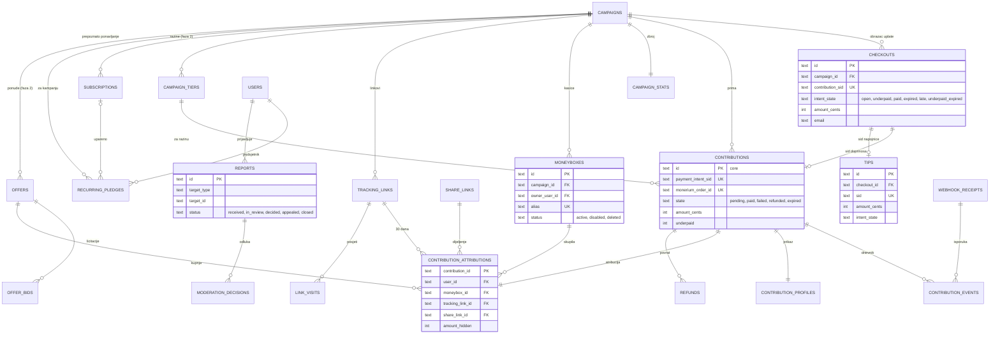

# 03 — Domenski model

Model platforme za UI prototip (S4–S8). Kampanja i novac su iz `campaign-core`, a sve društveno i
platformsko (računi, organizacije, uloge, verifikacije, mediji, komentari, kasice, linkovi, prijave)
su platformske tablice uz jezgru. Ulazi: obilazak (`research/obilazak/01–27`, sažetak u
[obilazak-polja-i-entiteti](research/2026-11-24-obilazak-polja-i-entiteti.md)), javni pregled §11 i
[izvadak campaign-core / MPT](research/2026-11-24-campaign-core-zajedno-izvadak.md). SQL je u
[09-d1-shema](09-d1-shema.md), tokovi u [04](04-tokovi.md), stanja u [05](05-zivotni-ciklus.md).

**Glavna teza:** kampanja pripada **organizaciji** (faza 1), a korisnik radi u ime organizacije kroz
članstvo s ulogom, kao na GitHubu (odluka 150). Novac nikad ne prolazi kroz platformu: doprinos je
projekcija MPT intenta (ili trajnog QR-a kampanje) koja se gradi iz webhooka.

## Konvencije (iz campaign-core)

- ID je `TEXT` (UUIDv7, generira Worker); novac u **centima** (`INTEGER`); vrijeme u **unix ms**.
  MPT šalje ISO stringove (webhook) i unix sekunde (rail), pretvorba je na rubu (webhook handler).
- Skup = `TEXT` + `CHECK (x IN (…))`; boolean `INTEGER CHECK (x IN (0,1))`; JSON `TEXT CHECK (json_valid(x))`.
- Jezgra nema `DEFAULT`; platformske tablice smiju imati `DEFAULT` (odluka 205).
- Brisanje kampanje i organizacije je soft delete (`deleted_at`).
- Jedan MPT tenant platforme (`sbx-…` u prototipu): `campaigns.tenant_id` je uvijek on (odluka 203).

## Entiteti

Izvor: **core** = tablica iz `campaign-core` v0.2.0 (`src/contract.ts`), koristi se bez izmjene ·
**platforma** = platformska tablica ovog repoa · **MPT** = stanje živi u railu, kod nas samo referenca.

### Identitet i organizacije

| Entitet (tablica) | Izvor | Kardinalnost | Značenje | Ekrani |
|---|---|---|---|---|
| Korisnik (`users`) | platforma | — | osoba s računom; e-pošta jedinstvena; nema prijenosa računa | 01, 10, 11, 13, 25 |
| Način prijave (`auth_identities`) | platforma | korisnik 1:N | `email_link`, `email_code`, `google`, `certilia` (kasnije); račun bez lozinke je normalan | 01, 13, 25 |
| Sesija (`sessions`) i prijava (`login_events`) | platforma | korisnik 1:N | mock kolačić (odluka 15); povijest prijava: vrijeme, IP skraćen, uređaj | 18 |
| Jednokratni kod (`one_time_codes`) | platforma | korisnik 1:N | 6 znamenki, 5 min; `purpose` = `login`, `email_verify`, `step_up` (osjetljiva radnja) | 14, 25, 27 |
| Postavke profila (`user_settings`) | platforma | korisnik 1:1 | 9 prekidača vidljivosti, `indexable`, metoda dodatne autentikacije | 12, 14 |
| Privola (`consents`) | platforma | korisnik ili e-pošta 1:N | uvjeti, newsletter, pravila kasice, GDPR uz prijavu; s verzijom teksta i vremenom | 01, 19, 22, 24, 26 |
| Organizator (`organizers`) | **core** | — | pravni nositelj kampanje: `holder_type`, naziv, OIB, adresa | 20, 26 |
| Organizacija (`organizations`) | platforma | organizator 1:1 | javni profil (slug, logo, opis, web, mreže), kategorija, `is_fixed_beneficiary`, status | 04, 20, 26 |
| Članstvo (`memberships`) | platforma | korisnik N:M organizacija | uloga po organizaciji: `owner`, `admin`, `editor`, `viewer`; `UNIQUE(user_id, organization_id)` | (odluka 150) |
| Pozivnica (`membership_invites`) | platforma | organizacija 1:N | e-pošta + uloga + token, 7 dana | (odluka 150) |
| Zahtjev organizacije (`organization_applications`) | platforma | organizacija 1:N | company application: opis projekta, očekivani broj uplata, 5 koraka | 20, 26 |
| Verifikacija (`verifications`) | platforma (+ EMI) | subjekt 1:N | `person_kyc`, `org_kyb`, `campaign_purpose`, `email`; kod nas samo status i referenca EMI-ja, ne podaci KYC-a | 02, 07, 09, 15, 20 |

### Kampanja

| Entitet (tablica) | Izvor | Kardinalnost | Značenje | Ekrani |
|---|---|---|---|---|
| Kampanja (`campaigns`) | **core** | organizator 1:N | naslov, opis, cilj, rok, stanje, vidljivost, `recurrence`, naslovnica | 03–07, 22 |
| Platformski dio kampanje (`campaign_settings`) | platforma | kampanja 1:1 | `kind` (`one_time`, `recurring`, `for_organization`), javni 6-znakovni ID, kategorija, tema naslovnice, korisnik-organizator, Fixed Beneficiary i odobrenje, postavke popisa uplata, komentara, kasica i ponuda, `paused_at`, `blocked_at`, `purpose_verified` | 03–08, 15, 22, 23 |
| Safe kampanje (`campaign_safes`) | **core** | kampanja 1:1 | odredište uplata; platforma ima 0 potpisnika | (02 „Kamo ide novac”) |
| Kategorija (`categories`) | platforma | — | 8 namjena (Dobrotvorno, Kultura, Projekti, Potrebe, Sport, Životinje, Putovanja, Ostalo) | 03, 08 |
| Medij (`campaign_media`) | platforma | kampanja 1:N | do 9 slika ili video poveznica; `position = 0` je naslovna | 05 |
| Tema naslovnice | konstanta | — | 15 tema, naše ilustracije; samo ključ u `campaign_settings.cover_theme` | 05 |
| Nacrt (`campaign_drafts`) | platforma | korisnik 1:N | JSON čarobnjaka; lokalno do prijave, pa na poslužitelj (odluka 152) | 03, 25 |
| Datoteka (`files`) | platforma | — | R2 ključ, MIME, veličina, namjena (`media`, `purpose_evidence`, `report_attachment`, `avatar`, `logo`) | 05, 10, 15, 22, 24 |
| Dokument kampanje (`campaign_documents`) | **core** | kampanja 1:N | dokazi namjene (troškovnik, rješenje); 4fund „Verify fundraisers” | 15 |
| Ažuriranje (`campaign_updates`) | platforma | kampanja 1:N | novost organizatora; opcionalno samo za razinu (faza 2) | 22 |
| Komentar (`comments`) | platforma | kampanja ili ažuriranje 1:N | do 2500 znakova, jedna razina odgovora, skrivanje, moderacija | 22, 23 |
| Praćenje (`campaign_follows`) | platforma | korisnik N:M kampanja | 3 prekidača: komentari, novosti, kraj | 19, 22 |
| Statistika (`campaign_stats`) | **core** | kampanja 1:1 | prikupljeno, broj doprinosa i uplatitelja; samo iz knjige | 08, 22 |

### Novac (projekcija MPT-a)

| Entitet (tablica) | Izvor | Kardinalnost | Značenje | Ekrani |
|---|---|---|---|---|
| Checkout (`checkouts`) | platforma | kampanja 1:N | jedna potvrda obrasca uplate: sidovi doprinosa i napojnice, e-pošta, atribucija; drži **logičko stanje intenta** | 19, 25 |
| Doprinos (`contributions`) | **core** | kampanja 1:N | red knjige; `payment_intent_sid` ili `monerium_order_id` jedinstveni; stanje iz [05](05-zivotni-ciklus.md) | 08, 19, 22 |
| Događaj doprinosa (`contribution_events`) | **core** | doprinos 1:N | dnevnik webhookova (samo dodavanje) | — |
| Profil doprinosa (`contribution_profiles`) | **core** | doprinos 1:1 | anonimnost, prikazno ime, poruka, `bank_verified` | 19, 22 |
| Atribucija (`contribution_attributions`) | platforma | doprinos 1:1 | korisnik (ako prijavljen), kasica, link za praćenje, dijeljenje, ponuda, skriveni iznos | 08, 16, 24 |
| Webhook primitak (`webhook_receipts`) | platforma | — | `webhook-id` PK, deduplikacija MPT isporuka | — |
| Napojnica (`tips`) | platforma | checkout 0..1 | zaseban intent na Safe ITalka; nikad u statistici kampanje (odluka 7) | 19 |
| Povrat (`refunds`) | platforma | doprinos 0..N | zapis povrata koji je organizator napravio iz Safea; platforma ne vraća novac | (02 „zapis povrata”) |
| Razina (`campaign_tiers`) | **core** | kampanja 1:N | razina podrške ili nagrada; faza 2 | 23 |
| Pretplata (`subscriptions`) | **core** | kampanja 1:N | prepoznato ponavljanje po `payer_iban_hash` | 17 |
| Obećanje ponavljanja (`recurring_pledges`) | platforma | korisnik 1:N, kampanja 1:N | mjesečni podsjetnik s QR-om (odluka 14); veza na core pretplatu kad je prepoznata | 17 |
| Kasica (`moneyboxes`) | platforma | kampanja 1:N | `/s/{alias}`, vlasnik bilo koji korisnik, novac na Safe glavne kampanje | 08, 22, 24 |
| Link za praćenje (`tracking_links`) | platforma | kampanja 1:N | `/z/{slug}`, vlasnik korisnik; atribucija 30 dana | 08, 16 |
| Link dijeljenja (`share_links`) | platforma | korisnik × kampanja 1:1 | automatski `?ref=` po korisniku i kampanji | 16 |
| Posjet linku (`link_visits`) | platforma | link 1:N | brojanje posjeta (jednom u 10 min po posjetitelju) | 16, 24 |
| Ponuda (`offers`) i ponuda u aukciji (`offer_bids`) | platforma | kampanja 1:N | faza 2, samo UI; kupnja = doprinos s atribucijom ponude | 23 |

### Moderacija, vanjsko, kontakt

| Entitet (tablica) | Izvor | Kardinalnost | Značenje | Ekrani |
|---|---|---|---|---|
| Prijava (`reports`) | platforma | cilj 1:N | DSA čl. 16: kampanja, komentar, ažuriranje, kasica, korisnik, organizacija; opis 50–500, privitak ≤ 20 MB | 22 |
| Odluka moderacije (`moderation_decisions`) | platforma | prijava 0..N | DSA čl. 17: radnja, obrazloženje, žalba | 22 |
| Vanjska kampanja (`external_campaigns`) | platforma | organizacija 1:N | kampanja s 4funda koju je dodao organizator: URL, oznaka, gumb na njihov `/pay`; bez naših uplata (odluka 9) | (02 „Hibrid”) |
| Poruka podršci (`contact_messages`) | platforma | — | 10 tema, Turnstile | 21 |
| Obavijest (`notifications`) | platforma | korisnik 1:N | izlazni red e-pošte (mock); izvor: praćenje, uplata, kasica, moderacija | 19, 22, 24 |

**Ne modeliramo:** isplatu, metodu isplate, limite isplate i napojnicu pri isplati (09, 14, 27: novac je
već kod organizatora, odluka 6), valute osim EUR, 12 metoda plaćanja (19), premium/promociju (faza 2,
samo UI), strojni prijevod.

## Ograničenja

1. **Kampanja pripada organizatoru iz jezgre**, a organizator organizaciji (1:1). Osobna kampanja
   (faza 2) je organizator s `holder_type = person` i organizacijom tipa `personal` s jednim članom.
   Tako jezgra ne zna ništa o korisnicima, a `created_by` u `campaigns` je `users.id`.
2. **Uloge** (`memberships.role`): `owner` upravlja članovima, KYB-om i brisanjem; `admin` objavljuje
   kampanje i odobrava tuđe (Fixed Beneficiary); `editor` uređuje kampanje, ažuriranja i komentare;
   `viewer` vidi financije i izvoz. Organizacija ima barem jednog `owner`a (provjerava Worker).
3. **Fixed Beneficiary** („kampanja za organizaciju”, 4fund `patronized`): pokreće je korisnik koji ne
   mora biti član organizacije. `campaigns.organizer_id` je organizator te organizacije (njoj ide novac,
   Safe je njezin), `campaigns.created_by` je korisnik, `campaign_settings.kind = for_organization` i
   `beneficiary_organization_id` je ta organizacija. Kampanja je `review` dok `admin` ili `owner`
   organizacije ne odobri; odbijanje je `cancelled` s razlogom.
4. **Uplata je moguća** samo kad vrijedi `canAcceptContributions` iz jezgre (aktivna, Safe provjeren,
   valjan prag, bez sukoba interesa) i kampanja nije `paused_at` ni `blocked_at`.
5. **Iznos nikad ne nosi identitet.** Veza checkout → doprinos je `sid`; atribucija ide u `metadata`
   intenta i u `contribution_attributions`, nikad u iznos.
6. **Napojnica nije doprinos kampanji:** ne ulazi u `contributions` kampanje ni u `campaign_stats`, ima
   vlastiti intent, a `0` je jednako istaknut izbor (odluka 7).
7. **Kasica i link za praćenje nemaju svoj novac:** uplata ide na Safe glavne kampanje, a kasica i link
   samo zbrajaju doprinose kroz atribuciju.
8. **Verifikacija namjene** iznad 5.000 € po kampanji ili 12.500 € po organizatoru diže zastavu i
   ručni pregled, ne blokadu (odluka 18). Nakon `approved` naslov, opis i cilj su zaključani.
9. **Podaci KYC-a ne ulaze u bazu.** EMI (Monerium/Swan) radi KYC/KYB; mi čuvamo stanje, pružatelja i
   referencu. Sirovi IBAN uplatitelja se ne sprema, samo HMAC (`payer_iban_hash`).
10. **Javni popis uplatitelja** poštuje `contribution_profiles.anonymous` i
    `contribution_attributions.amount_hidden`; `sender_name` iz webhooka nikad nije javan.

## Dijagram: identitet, organizacija, kampanja

```mermaid
erDiagram
  USERS ||--o{ AUTH_IDENTITIES : "prijavljuje se"
  USERS ||--o{ SESSIONS : ima
  USERS ||--|| USER_SETTINGS : postavke
  USERS ||--o{ CONSENTS : daje
  USERS ||--o{ MEMBERSHIPS : "član je"
  ORGANIZATIONS ||--o{ MEMBERSHIPS : "ima članove"
  ORGANIZATIONS ||--o{ MEMBERSHIP_INVITES : poziva
  ORGANIZERS ||--|| ORGANIZATIONS : "javni profil"
  ORGANIZATIONS ||--o{ ORGANIZATION_APPLICATIONS : "company application"
  ORGANIZERS ||--o{ CAMPAIGNS : organizira
  CAMPAIGNS ||--|| CAMPAIGN_SETTINGS : "platformski dio"
  CAMPAIGNS ||--o| CAMPAIGN_SAFES : "novac ide na"
  CATEGORIES ||--o{ CAMPAIGN_SETTINGS : klasificira
  ORGANIZATIONS ||--o{ CAMPAIGN_SETTINGS : "Fixed Beneficiary"
  USERS ||--o{ CAMPAIGN_DRAFTS : "nacrt"
  CAMPAIGNS ||--o{ CAMPAIGN_MEDIA : galerija
  FILES ||--o{ CAMPAIGN_MEDIA : datoteka
  CAMPAIGNS ||--o{ CAMPAIGN_DOCUMENTS : dokazi
  CAMPAIGNS ||--o{ CAMPAIGN_UPDATES : novosti
  CAMPAIGNS ||--o{ COMMENTS : komentari
  CAMPAIGN_UPDATES ||--o{ COMMENTS : komentari
  USERS ||--o{ COMMENTS : pise
  USERS ||--o{ CAMPAIGN_FOLLOWS : prati
  CAMPAIGNS ||--o{ CAMPAIGN_FOLLOWS : pratitelji
  VERIFICATIONS }o--o| USERS : "person_kyc"
  VERIFICATIONS }o--o| ORGANIZATIONS : "org_kyb"
  VERIFICATIONS }o--o| CAMPAIGNS : "campaign_purpose"
  ORGANIZATIONS ||--o{ EXTERNAL_CAMPAIGNS : "dodaje (4fund)"

  USERS {
    text id PK
    text email UK
    text display_name
    int email_verified_at
    int deleted_at
  }
  ORGANIZATIONS {
    text id PK
    text organizer_id FK "1:1 core organizers"
    text slug UK
    text status "pending, active, suspended, closed"
    int is_fixed_beneficiary
  }
  MEMBERSHIPS {
    text user_id FK
    text organization_id FK
    text role "owner, admin, editor, viewer"
  }
  CAMPAIGNS {
    text id PK "core"
    text organizer_id FK
    text state "draft, review, active, funded, closed, cancelled"
    int goal_cents
    int ends_at
  }
  CAMPAIGN_SETTINGS {
    text campaign_id PK
    text public_id UK "6 znakova"
    text category_key FK
    text beneficiary_organization_id FK
    int paused_at
    int blocked_at
  }
  VERIFICATIONS {
    text id PK
    text kind "person_kyc, org_kyb, campaign_purpose, email"
    text subject_type
    text subject_id
    text status
  }
```

## Dijagram: novac, kasice, linkovi, moderacija

## Pokrivenost ekrana obilaska

| # | ekran | entiteti |
|---|---|---|
| 01 | Registracija | users, auth_identities, consents, one_time_codes (`email_verify`) |
| 02 | Verifikacija računa | verifications (`person_kyc`), users |
| 03 | Čarobnjak: tip i namjena | campaign_drafts, categories, campaign_settings (tip) |
| 04 | Čarobnjak: naslov, cilj, organizacija | campaign_drafts, campaigns, organizations (Fixed Beneficiary) |
| 05 | Čarobnjak: mediji | campaign_media, files, `cover_theme` |
| 06 | Čarobnjak: opis | campaigns.description |
| 07 | Čarobnjak: pregled | campaigns, verifications (oznaka organizatora) |
| 08 | Moje kampanje | campaigns, campaign_settings (`paused_at`), contributions + attributions (doniralo), moneyboxes, tracking_links |
| 09 | Isplata (ulaz) | ✗ isplata; ekran „Kamo ide novac” iz campaign_safes, verifications |
| 10 | Postavke: podaci | users, files (`avatar`) |
| 11 | Postavke: telefon | users.phone (samo uz verificiran račun) |
| 12 | Postavke: profil, brisanje | user_settings, consents, users.deleted_at |
| 13 | Postavke: lozinka | auth_identities (lozinke nema: magic link, ekran = upravljanje načinima prijave) |
| 14 | Postavke: limiti i autentikacija | user_settings.step_up_channel, one_time_codes (`step_up`); limiti ✗ |
| 15 | Postavke: verifikacija kampanja | verifications (`campaign_purpose`), campaign_documents, files |
| 16 | Postavke: linkovi | tracking_links, share_links, link_visits |
| 17 | Postavke: ponavljajuće | recurring_pledges, subscriptions |
| 18 | Postavke: povijest prijava | login_events |
| 19 | Checkout | checkouts, contributions, contribution_profiles, contribution_attributions, tips, consents, campaign_follows |
| 20 | Company application, Fixed Beneficiary | organizations, organization_applications, verifications (`org_kyb`), memberships |
| 21 | Kontakt | contact_messages |
| 22 | Praćenje, prijava, komentari | campaign_follows, reports, files, comments, campaign_updates, moneyboxes, contributions (popis) |
| 23 | Ponude, Founder's Offer | offers, offer_bids, campaign_settings (`allow_external_offers`), verifications |
| 24 | Kasica | moneyboxes, consents (`moneybox_rules`) |
| 25 | Anonimno: prijava, kod, reset, nacrt | auth_identities, one_time_codes (`login`), campaign_drafts (lokalni) |
| 26 | Company application poslan | organization_applications (korak 3/5), verifications (`org_kyb`) |
| 27 | Dodatna autorizacija kodom | one_time_codes (`step_up`) |

Svih 27 ekrana ima entitet; 09 i 14 (limiti) su svjesno izvan modela jer isplate nema.

## Razlika prema campaign-core

Što 4fund-klon treba, a jezgra nema, i gdje to rješavamo. **Izmjene campaign-corea se ne rade**
(pravilo lanca); stupac „Prijedlog” je bilješka za vlasnika jezgre.

| Nedostaje | Jezgra danas | Rješenje u prototipu | Prijedlog za campaign-core |
|---|---|---|---|
| korisnici, prijava, sesije | ✗ (D5: bez računa) | platforma: `users`, `auth_identities`, `sessions` | ne; ostaje platformsko (D5 vrijedi) |
| organizacija kao javni profil | `organizers` bez slug-a, loga, statusa | platforma: `organizations` 1:1 | ne |
| članstva i uloge | ✗ (`members` je vertikala zajednice) | platforma: `memberships`, `membership_invites` | ne |
| KYC / KYB / verifikacija namjene | ✗ | platforma: `verifications` | ne |
| zaklada kao nositelj | `HOLDER_TYPES` nema `foundation` | `holder_type = association` + `organizations.legal_form = zaklada` | **da**: dodati `foundation` u `HOLDER_TYPES` |
| kategorija, tema, javni kratki ID | ✗ | platforma: `campaign_settings`, `categories` | ne |
| privremeno isključena (Turn off) i blokirana kampanja | `CAMPAIGN_STATES` nema `paused`/`blocked` | platforma: `paused_at`, `blocked_at` u `campaign_settings` | razmotriti `paused` u `CAMPAIGN_STATES` ako ga zatraži i druga platforma |
| galerija | samo `cover_image_url` | platforma: `campaign_media`, `files` | ne |
| ažuriranja, komentari, praćenje | ✗ | platforma | ne |
| dokaz namjene (medicinski, ostalo) | `DOCUMENT_KINDS` nema odgovarajuću vrstu | `kind = other` + `label` | **da**: dodati `purpose_evidence` u `DOCUMENT_KINDS` |
| skriveni iznos doprinosa | `contribution_profiles` ima `anonymous`, nema skrivanje iznosa | platforma: `contribution_attributions.amount_hidden` | **da**: `contribution_profiles.amount_hidden` (prikaz pripada profilu) |
| atribucija (kasica, link, dijeljenje, ponuda, korisnik) | ✗ | platforma: `contribution_attributions` 1:1 | ne; atribucija je platformska |
| `underpaid` i `late` | `CONTRIBUTION_STATES` nema; postoji zastavica `underpaid` | preslikavanje u [05](05-zivotni-ciklus.md), logičko stanje u `checkouts.intent_state` | ne |
| checkout prije doprinosa, napojnica | ✗ | platforma: `checkouts`, `tips` | ne |
| kasica, link za praćenje, dijeljenje | ✗ | platforma | ne |
| ponude i aukcije | ✗ (razina je fiksna cijena) | platforma: `offers`, `offer_bids` (faza 2) | ne dok pravnik ne potvrdi prodaju |
| ponavljanje vezano uz korisnika | `subscriptions` samo po `payer_iban_hash` | platforma: `recurring_pledges` s vezom na `subscriptions` | ne |
| povrat | stanje `refunded`, bez zapisa | platforma: `refunds` (Safe tx organizatora) | ne |
| vanjska kampanja | `campaign_subjects` (`external:`) služi projekcijama | platforma: `external_campaigns` (nije core kampanja: nema Safe ni doprinosa) | ne |
| prijave i moderacija | ✗ (`state = review` postoji) | platforma: `reports`, `moderation_decisions` | ne |
| deduplikacija webhooka | ✗ | platforma: `webhook_receipts` | ne |
| migracije (J2) | **ne postoje** u campaign-core | S4 generira `0001_core.sql` iz `contract.ts` paketa (vidi [09](09-d1-shema.md)) | **da**: J2 u campaign-coreu bi to učinio zajedničkim |

Tri prijedloga za jezgru (`foundation`, `purpose_evidence`, `amount_hidden`) i J2 zapisani su u
[decisions](decisions.md) 213; prototip radi i bez njih.

## Kartica uplate i ID-evi

- `campaigns.id` (UUIDv7, 36 znakova) zadovoljava MPT `^[A-Za-z0-9_-]{6,64}$` i registrira se u railu
  (`tenant_campaigns`) kad kampanja postane `active`; tad radi i trajni QR (`campaign-qr`).
- `campaign_settings.public_id`: 6 znakova Crockford base32 bez `0/O/1/I`, za URL `/{public_id}`.
- `checkouts.contribution_sid` i `tips.sid`: 22 znaka base64url (≤ 32, ide on-chain kao bytes32),
  generira Worker, pa je ponovljeno slanje idempotentno (`409 sid_already_exists` = već kreirano).
