# 04 — Tokovi

Sequence po toku. Entiteti su u [03](03-domenski-model.md), stanja u [05](05-zivotni-ciklus.md),
MPT API u [izvatku](research/2026-11-24-campaign-core-zajedno-izvadak.md) §D. Sudionici:

| kratica | tko |
|---|---|
| `K`, `P`, `O`, `M` | korisnik, podržavatelj, organizator (član organizacije), moderator |
| `W` | Astro SSR Worker platforme (stranice, API rute, webhook) |
| `D` | D1 (campaign-core + platformske tablice) |
| `MPT` | `api.mpt.hr/v1` (u prototipu sandbox tenant `sbx-…`, `sk_test_`) |
| `EMI` | Monerium ili Swan (KYC/KYB, SEPA) |
| `S` | Safe kampanje ili organizacije |
| `E` | izlazna e-pošta (u prototipu mock red `notifications`) |

Pravila koja vrijede za sve tokove: doprinos se knjiži samo iz webhooka ili statusa koji je Worker sam
pročitao; iznos nikad ne nosi identitet; osjetljive radnje organizatora traže kod e-poštom (`step_up`).

## 1. Registracija, prijava i verifikacija osobe

4fund: 01, 02, 13, 25. Kod nas nema lozinke: magic link ili kod e-poštom (odluka 15, mock bez slanja).
KYC radi EMI kad organizator otvara račun; mi čuvamo samo stanje.

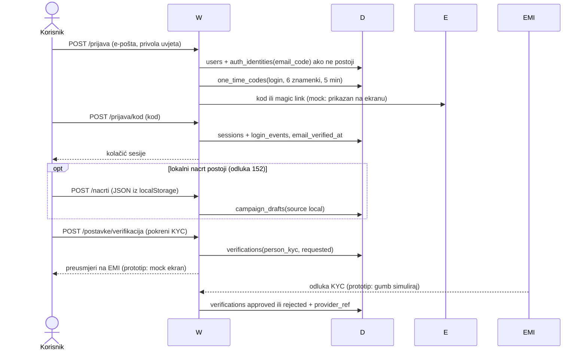

## 2. Organizacija, KYB i članovi

4fund: 20, 26 (company application, 5 koraka). Kod nas organizacija s članovima i ulogama (odluka 150).
KYB radi EMI, Safe organizacije postavlja `owner` kroz setup dApp (MPT ADR 0027); platforma nema potpisnika.

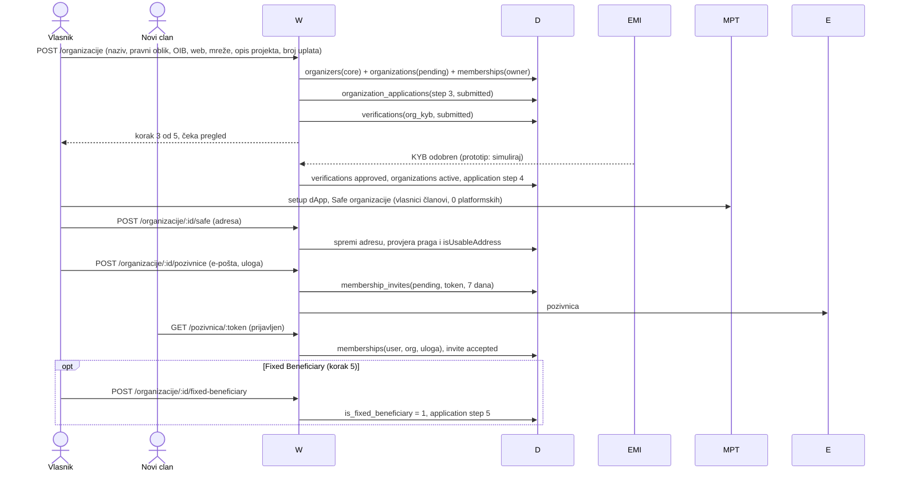

## 3. Objava kampanje

4fund: 03–07 (čarobnjak), 15 (verifikacija namjene). Nacrt lokalno do prijave, zatim na poslužitelju.
Kampanja za organizaciju (Fixed Beneficiary) čeka odobrenje te organizacije.

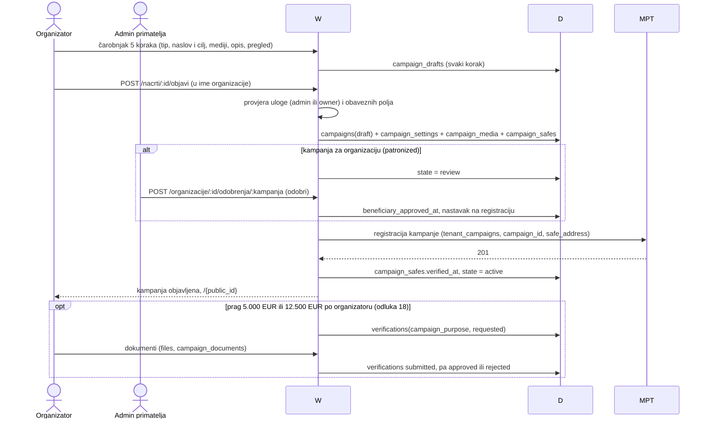

## 4. Uplata kroz MPT intent i webhook

4fund: 19 (checkout), 25 (bez prijave). Polja kao 4fund (iznos, poruka do 300, skrij ime, skrij iznos,
e-pošta, obavijesti), plaćanje = MPT intent (QR, IBAN, referenca, `short_ref`).

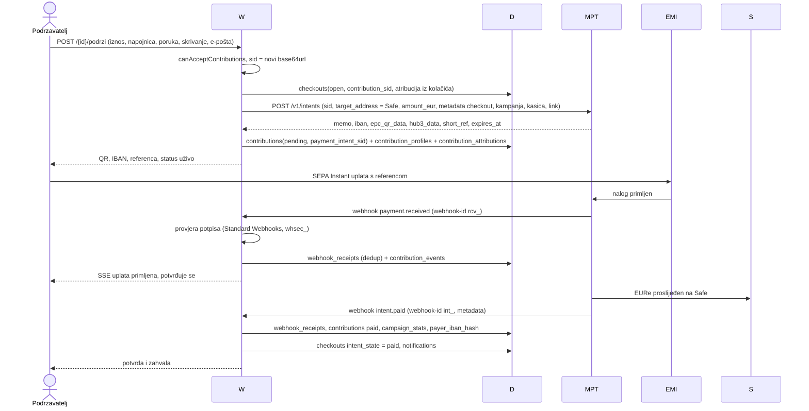

Ponovljeni webhook s istim `webhook-id` vraća 200 bez upisa. `payment.underpaid`, `payment.late` i
`payment.rejected` slijede tablicu iz [05](05-zivotni-ciklus.md). Pull rezerva: ako webhook ne stigne do
`wrangler dev`, stranica statusa zove `GET /v1/intents/:sid` i Worker upisuje isto kao iz webhooka.

## 5. Napojnica

4fund: 19 (klizač 0–30 %, zadano 20 %). Kod nas zaseban intent na Safe platforme (ITalk), zadano 0 ili
bez zadanog izbora, „0” jednako istaknut (odluka 7). Napojnica nikad ne ulazi u kampanju.

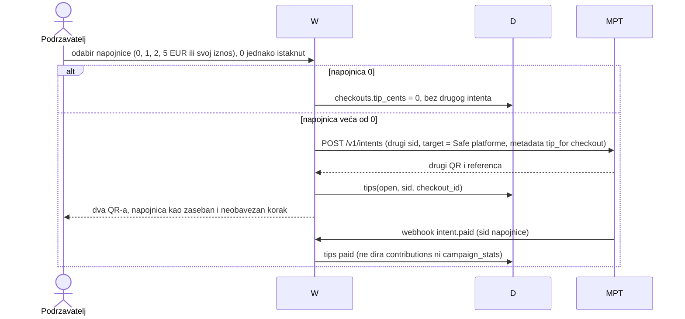

## 6. Kasica

4fund: 24 (obrazac), 22 (tab kasica), 08 (moje kasice). Kasicu otvara bilo koji prijavljeni korisnik za
tuđu ili svoju kampanju, bez verifikacije; novac ide na Safe glavne kampanje.

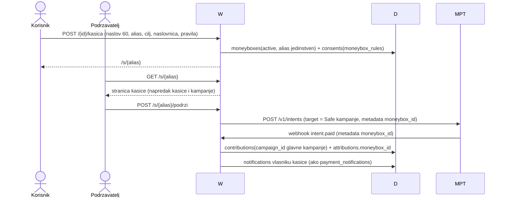

## 7. Link za praćenje i dijeljenje

4fund: 16, 08 („Create a tracking link”). `/z/{slug}` i automatski `?ref=` po korisniku. Atribucija 30
dana kroz kolačić, posjet se broji jednom u 10 minuta.

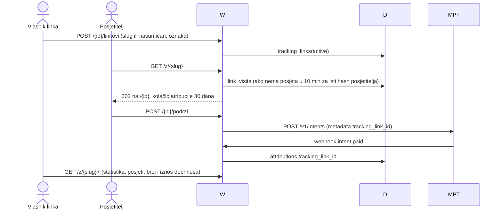

Isto za dijeljenje: `?ref={share_code}` stvara ili čita `share_links(user, campaign)` i postavlja isti
kolačić. Ako postoje oba, vrijedi zadnji klik.

## 8. Prijava sadržaja i moderacija

4fund: 22 (Report abuse: opis 50–500, telefon, privitak 20 MB, GDPR). Kod nas DSA čl. 16 (prijava i
potvrda primitka) i čl. 17 (obrazložena odluka i žalba).

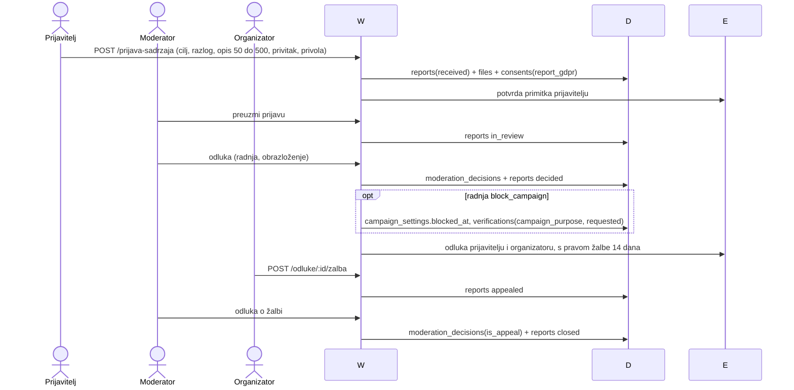

## 9. Vanjska kampanja (hibrid, 4fund)

Organizator dodaje svoju kampanju s 4funda (odluka 9). Mi ne uvozimo katalog i ne primamo uplate za nju:
gumb vodi na njihov `/{id}/pay`. Iznos s 4funda čitamo samo ako to uvjeti dopuštaju (provjera u S8).

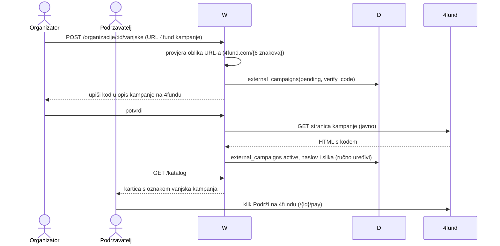

## 10. Ponavljanje (podsjetnik)

4fund: 17, recurring samo karticom. Monerium nema SEPA DD, pa ponavljanje je mjesečni podsjetnik s novim
QR-om ili uputa za trajni nalog (odluka 14). Prepoznata ponavljanja jezgra bilježi u `subscriptions` po
`payer_iban_hash`.

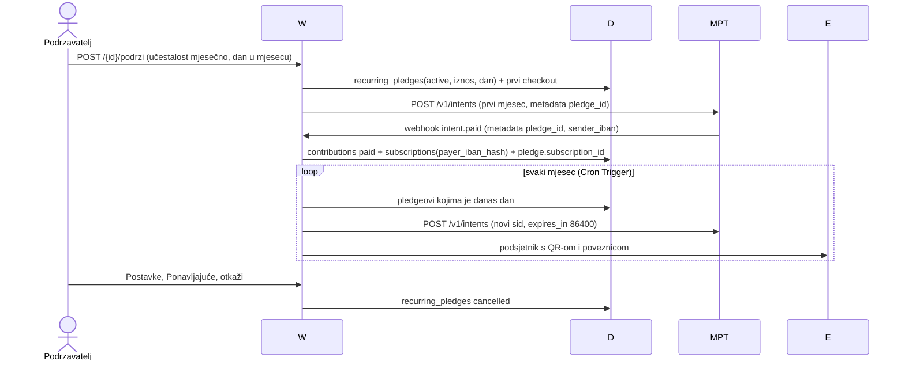

Alternativa trajnog naloga: Worker pokaže trajni QR kampanje (`GET /v1/intents/campaign-qr`) i uputu za
trajni nalog u banci; svaka uplata dolazi kao `contribution.sepa` i jezgra je prepoznaje po IBAN hashu.

## 11. Povrat

4fund: „Return selected” u financijama, 0,50 € (javni pregled §6). Kod nas platforma ne drži novac: povrat
je odlazna transakcija organizatora iz Safea (ili s računa), a platforma ga samo bilježi.

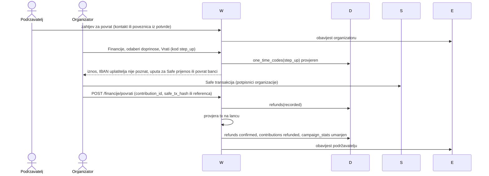

Napomena: IBAN uplatitelja platforma nema (samo HMAC), pa povrat na IBAN ide kroz EMI organizatora (Monerium
redeem na IBAN koji podržavatelj sam upiše) ili on-chain na adresu. Rješenje za prototip je ručni zapis.

## 12. Trajni QR kampanje (bez checkouta)

Poster, widget i ispis koriste trajni QR (`cmp:` referenca). Nema checkouta ni napojnice.

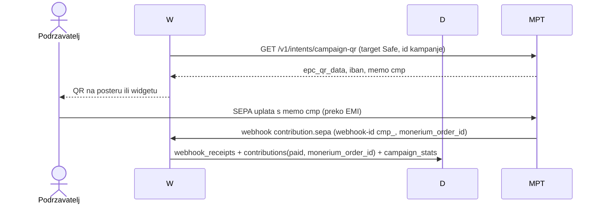

## Pokrivenost

| tok (handoff S2) | sekcija |
|---|---|
| registracija i verifikacija | 1 |
| organizacija i KYB | 2 |
| objava kampanje | 3 |
| uplata kroz MPT intent i webhook | 4 (+ 12 trajni QR) |
| napojnica | 5 |
| kasica | 6 |
| tracking | 7 |
| prijava i moderacija | 8 |
| vanjska kampanja | 9 |
| recurring podsjetnik | 10 |
| povrat | 11 |
