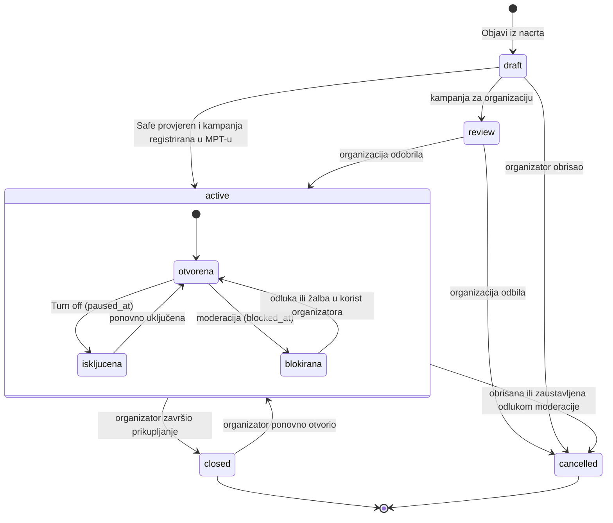
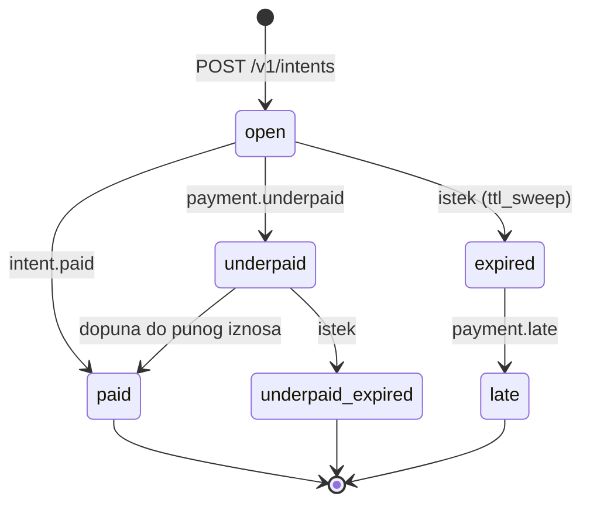
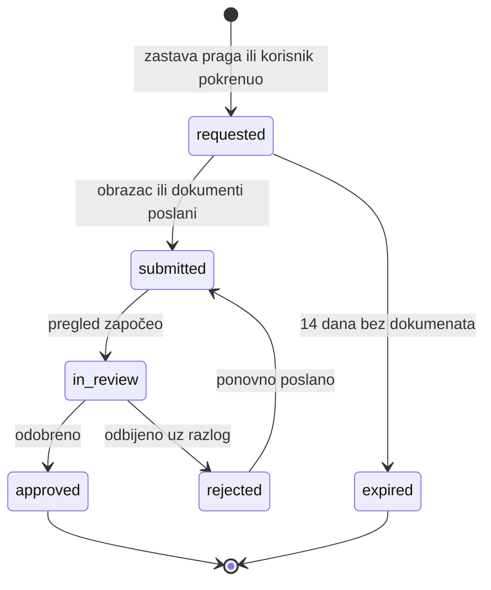
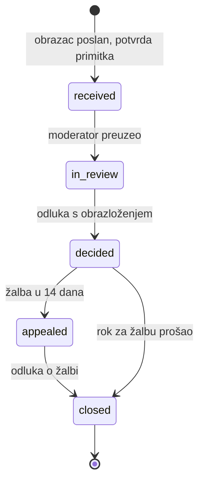

# 05 — Životni ciklus

Stanja kampanje, doprinosa, verifikacije, prijave i manjih entiteta. Entiteti su u
[03](03-domenski-model.md), okidači u [04](04-tokovi.md), skupovi kao `CHECK` u [09](09-d1-shema.md).
Imena stanja u dijagramima su vrijednosti iz baze; prijelaz nosi okidač.

## Kampanja

Os prikupljanja je `campaigns.state` iz jezgre (`draft`, `review`, `active`, `funded`, `closed`,
`cancelled`). 4fundova stanja „Active / Disabled / Deleted” (ekran 08) i blokada moderacije su
**preklopi** u platformskoj tablici, ne nova stanja jezgre (odluka 204):

| 4fund | kod nas | gdje |
|---|---|---|
| Active | `state = active`, `paused_at IS NULL` | core + `campaign_settings` |
| Disabled („Turn off”, vraća se) | `paused_at` postavljen; stranica vidljiva, uplate zatvorene | `campaign_settings.paused_at` |
| Deleted | `state = cancelled` + `deleted_at` | core |
| privremeno blokirana (moderacija) | `blocked_at` + `blocked_reason`; stranica s obavijesti, uplate zatvorene | `campaign_settings` |
| čeka odobrenje organizacije (patronized) | `state = review` | core |
| nakon roka i dalje aktivna | `state = active`; „ističe za” nestaje | core |
| cilj dosegnut | ostaje `active` (zadrži sve, nema all-or-nothing) | — |

Pravila:

- Uplate prima samo `active` + `otvorena` (uz `canAcceptContributions` iz jezgre). U `closed`,
  `iskljucena` i `blokirana` gumb „Podrži” je onemogućen; trajni QR i dalje može donijeti
  `contribution.sepa` — takav doprinos se knjiži (novac je već na Safeu) i označi u financijama.
- `funded` se u fazi 1 ne koristi (cilj ne zatvara kampanju, kao 4fund). Ostaje u skupu jezgre.
- `slug` jezgre je nepromjenjiv nakon `active`; javni ID (`public_id`) je nepromjenjiv od nastanka.
- Verifikacija namjene `approved` zaključava `title`, `description` i `goal_cents` (Worker odbija izmjenu).
- Brisanje je soft delete: `deleted_at` + `state = cancelled`; kasice kampanje postaju `deleted`.

## Doprinos (preslikavanje MPT intenta)

MPT ima šest logičkih stanja intenta (`pay.domovina.ai` `backend/src/intents/intentStates.ts`). Platforma
logičko stanje drži doslovno u `checkouts.intent_state` (i `tips.intent_state`), a `contributions.state`
jezgre dobiva preslikanu vrijednost (odluka 206):

| `intent_state` (checkout) | `contributions.state` | `underpaid` | broji se u `campaign_stats` | napomena |
|---|---|---|---|---|
| `open` | `pending` | 0 | ne | red doprinosa nastaje s kreiranjem intenta |
| `open` + `payment.received` | `pending` | 0 | ne | UI smije pokazati „uplata primljena, potvrđuje se”; `received_at` u događaju |
| `paid` | `paid` | 0 | da, `amount_received_cents` | preplata je i dalje `paid` |
| `underpaid` | `pending` | 1 | ne | čeka dopunu ili istek |
| `underpaid_expired` | `paid` | 1 | da, primljeni iznos | novac **jest** na Safeu (`funds_location: recipient`) |
| `expired` | `expired` | 0 | ne | nije terminalno: može postati `late` |
| `late` | `paid` | 0 | da | kasni novac je kod organizatora; platforma ga ne može odbiti |
| `rejected` (`payment.rejected`) | `failed` | 0 | ne | Monerium vratio novac uplatitelju; `rejected` je platformska vrijednost u `checkouts`, MPT intent ostaje `open` |
| — (povrat iz Safea) | `refunded` | — | oduzima se | samo platformski, iz `refunds` (vidi 04 „Povrat”) |
| `contribution.sepa` (trajni QR) | `paid` | 0 | da | bez checkouta; ključ `monerium_order_id` |

Doprinos se odobrava **samo iz webhooka ili statusa koji je Worker sam pročitao** (`GET /v1/intents/:sid`),
nikad iz `mpt_status` u `return_url`. Napojnica ima isti dijagram, ali piše samo u `tips`.

## Verifikacija

Jedan skup za sve vrste (`person_kyc`, `org_kyb`, `campaign_purpose`, `email`). Kod `person_kyc` i
`org_kyb` stanje dolazi od EMI-ja (u prototipu mock gumb „simuliraj odluku”).

- `campaign_purpose` se ne može povući nakon `submitted`; `rejected` ili `expired` kod nje vodi na
  `blocked_at` kampanje i odluku moderacije (DSA obrazloženje).
- `email` ide `requested → approved` kodom (6 znamenki, 5 min) ili magic linkom; drugih stanja nema.
- Korisnik je „verificiran” kad ima `person_kyc = approved`; organizacija je `active` kad ima
  `org_kyb = approved`.

## Prijava (DSA čl. 16–17)

Radnja odluke (`moderation_decisions.action`): `no_action`, `hide_content`, `restrict_feature`,
`block_campaign`, `suspend_account`. Odluka se šalje prijavitelju i vlasniku sadržaja. Rok odluke 14 dana
je cilj, ne tvrdo stanje.

## Manji entiteti

| entitet | stanja | prijelazi |
|---|---|---|
| organizacija (`organizations.status`) | `pending`, `active`, `suspended`, `closed` | KYB `approved` → `active`; moderacija → `suspended`; `owner` zatvara → `closed` |
| zahtjev organizacije (`organization_applications.step`) | 1 račun · 2 verifikacija osobe · 3 obrazac · 4 pregled · 5 Fixed Beneficiary (neobavezno) | `status`: `draft`, `submitted`, `approved`, `rejected` |
| pozivnica (`membership_invites`) | `pending`, `accepted`, `revoked`, `expired` | 7 dana |
| kasica (`moneyboxes.status`) | `active`, `disabled`, `deleted` | kao 4fund (08); brisanje kampanje → `deleted` |
| link za praćenje | `active`, `disabled` | posjet se broji samo na `active` |
| obećanje ponavljanja (`recurring_pledges.status`) | `active`, `paused`, `cancelled` | podsjetnik samo za `active`; 3 propuštena mjeseca → `paused` |
| povrat (`refunds.status`) | `recorded`, `confirmed` | organizator upiše Safe tx ili bankovnu referencu; `confirmed` kad je tx na lancu → doprinos `refunded` |
| komentar | vidljiv, `hidden_at` (organizator ili moderacija), `deleted_at` | — |
| vanjska kampanja (`external_campaigns.status`) | `pending`, `active`, `removed` | `pending` dok organizator ne potvrdi da je vlasnik (tekst u opisu 4fund kampanje) |
| ponuda (faza 2) | `draft`, `active`, `sold`, `ended`, `cancelled` | samo UI |
