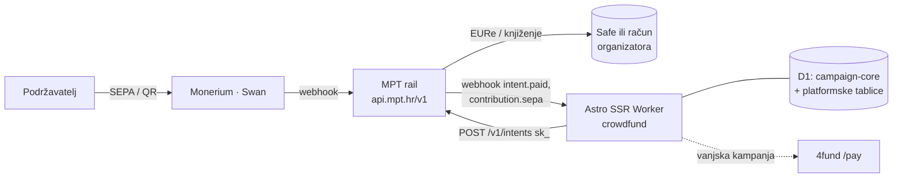

# 06 — Arhitektura

Detalji i putanje: [mapa ponovne upotrebe](research/2026-11-24-mapa-ponovne-upotrebe.md).

| Sloj | Izbor | Zašto |
|---|---|---|
| Web | Astro 7 `output: "server"`, `@astrojs/cloudflare`, otoci (React samo gdje treba stanje) | korisnikov izbor; već radi u `omm.domovina.ai` i `domovina-ulaznice/web` |
| Runtime | jedan Cloudflare Worker za prototip (SSR + API rute + webhook) | najmanje pokretnih dijelova; podjela na web + API Worker (uzor ulaznice) kasnije |
| Baza | D1; shema kampanje iz `campaign-core` `src/contract.ts`, plus platformske tablice (korisnici, organizacije, verifikacije, ažuriranja, komentari, kasice, linkovi za praćenje, prijave, vanjske kampanje) | jedna istina za sve frontendove (energy `docs/19`) |
| Plaćanje | platforma = MPT tenant; razvoj na `sbx-` tenantu (`sk_test_`, `simulate`) | ADR 0024; novac nikad ne prolazi kroz platformu |
| Kod za novac | port iz energy `lib/mpt-intent.ts`, `payer-tags.ts`, `receipt-*` u zajednički paket, ne treća kopija | energy i mpt-landing već imaju dvije kopije |
| Testovi | vitest (logika, D1 kroz miniflare), Playwright e2e na `wrangler dev` | bez mreže u unit testovima |

Otvoreno: zaseban D1 ili dijeljeni s campaign-core J2 (energy `docs/19` D2 kaže zaseban D1
i Worker jezgre; prototip ide sa svojim D1 i istom shemom, spajanje je odluka nakon S9).
