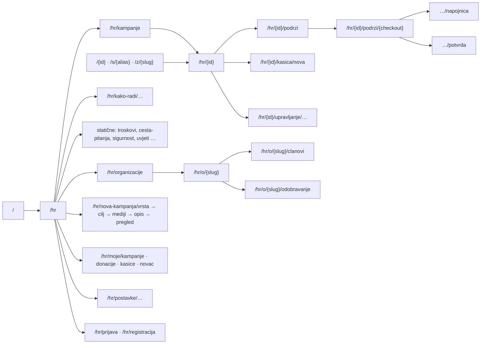

# 07 — Rute

Sitemap prototipa (hr + en), zahtjev prijave po ruti i preslikavanje svake rute 4funda na našu rutu ili ✗ s
razlogom. Ulazi: [forfund-route-templates](research/forfund-route-templates.txt) (mapa stranice 4funda),
inventar obilaska ([obilazak/README](research/obilazak/README.md)), javni pregled §12, pokrivenost ekrana u
[03](03-domenski-model.md) i tokovi u [04](04-tokovi.md). Odluke 300–304, 309–310, 312–313 u [decisions](decisions.md).

## Konvencije

1. **Jezik je prvi segment:** `/hr/…` i `/en/…`, segmenti su prevedeni (`/hr/kampanje`, `/en/campaigns`).
   `/` preusmjerava (302) na `/hr` ili `/en` po kolačiću `lang`, pa po `Accept-Language`, zadano `hr`
   (odluka 300). `hreflang` par na svakoj javnoj stranici.
2. **Kratki linkovi su bez jezika:** `/{id}` (kampanja), `/s/{alias}` (kasica), `/z/{slug}` (link za praćenje).
   Preusmjeravaju na `/{lang}/…` istim redom kao `/` (odluka 301).
3. **Javni ID kampanje** je 6 znakova Crockford base32 (odluka 212): abeceda `0–9 A–Z` bez `I L O U`, piše se
   malim slovima, a čita neovisno o veličini. Statični segment od 6 znakova **na mjestu gdje može stajati ID**
   (prvi segment iza `/{lang}/` i prvi segment rute bez jezika) mora sadržavati slovo izvan abecede (`i`, `l`,
   `o`, `u`) ili crticu, pa se ne može sudariti s ID-om; test u S4 (odluke 302, 401). Dublji segmenti
   (`manage`, `stream`, `drafts`, `events`) ne mogu se sudariti i izuzeti su.
4. **Upravljanje kampanjom je ispod nje:** `/hr/{id}/upravljanje/…`; organizacija ispod `/hr/o/{slug}/…`;
   osobno ispod `/hr/moje/…` i `/hr/postavke/…`.
5. **Radnje su `POST` na istu rutu** (obrazac radi i bez JS-a) ili na `/api/…` za otoke; nema `GET` koji mijenja
   stanje. Brisanja i promjene uloga traže dodatnu potvrdu kodom (odluka 208).
6. **Ključevi upitnih parametara su engleski u oba jezika** (`?q=`, `?category=`, `?sort=`); vrijednosti su
   ključevi iz baze (`categories.key`), a prevodi se samo prikaz (odluka 303).

## Razine pristupa

| Oznaka | Značenje | Provjera |
|---|---|---|
| J | javno, bez prijave | — |
| J* | javno, prijava neobavezna; prijavljenom se nudi više (npr. checkout bez e-pošte, odluka 153) | — |
| P | prijavljen korisnik | sesija |
| P+e | prijavljen + svježa dodatna potvrda kodom e-poštom (≤ 10 min) | `one_time_codes.purpose = step_up` |
| U:uloga | član organizacije s barem tom ulogom (`viewer` < `editor` < `admin` < `owner`, odluka 202) | `memberships` |
| K | uloga u organizaciji kampanje **ili** autor kampanje za organizaciju dok čeka odobrenje | `campaigns.created_by`, `memberships` |
| V | vlasnik objekta (kasica, link za praćenje, obećanje ponavljanja, nacrt) | `owner_user_id` |
| T | posjednik tokena iz poveznice (pozivnica, praćenje, podsjetnik, dodatna potvrda) | token, rok |
| A | moderator platforme | `users.platform_role = moderator` (mock) |

Kampanja koja nije javno vidljiva (`draft`, `review`, `cancelled`, `blocked_at`) vraća 404 svima osim K i A;
neindeksirana (`visibility = unlisted`) vraća 200 s `noindex` i ne ulazi u katalog.

Provjera u kodu (S6): `src/lib/pristup.ts`. Neprijavljeni na P/P+e/K/U/A ruti dobiva 302 na
`/{lang}/prijava?next=<put+upit>`; prijavljeni bez prava 404 (i za A: postojanje moderacije se ne otkriva).
Moderator prolazi K, ali ne U:uloga. P+e: bez potvrde u zadnjih 10 min 302 na `/{lang}/potvrda-radnje/{token}`,
gdje je token id retka `one_time_codes(step_up)` tog korisnika. Provjera ruta (`npm run routes`) računa očekivani
status iz stupca „Pristup” i P/K/U/A rute zove i s demo sesijom iz `seed/primjeri.json`.

## Sitemap

### Javni dio (S5)

| hr | en | Pristup | Sadržaj | Ekran / izvor |
|---|---|---|---|---|
| `/` | `/` | J | 302 na `/hr` ili `/en` | — |
| `/hr` | `/en` | J | naslovnica: 3 vrste kampanje, urednički izbor, brojači iz knjige, kategorije | pregled §8.2 |
| `/hr/kampanje` | `/en/campaigns` | J | katalog: `q`, `category`, `type` (`one_time`, `recurring`, `for_organization`), `verified`, `moneyboxes`, `ending`, `successful`, `near`, `sort`, `page` | pregled §8.1 |
| `/hr/organizacije` | `/en/organisations` | J | katalog organizacija, filtar kategorije, CTA „Pokreni kampanju za organizaciju” | pregled §8.4 |
| `/hr/za-organizaciju` | `/en/for-organisations` | J | objašnjenje kampanje za organizaciju (Fixed Beneficiary), odobrenje, kamo ide novac | pregled §2.4 |
| `/hr/mjesecne` | `/en/monthly` | J | mjesečne kampanje: podsjetnik + QR ili trajni nalog (odluka 14) | pregled §12 |
| `/hr/ponude` | `/en/offers` | J | katalog ponuda; oznaka „nije u fazi 1” | 23, pregled §8.3 |
| `/hr/ponude/nova` | `/en/offers/new` | P | odabir kampanje (`?campaign=`) i obrazac ponude; sprema samo nacrt; „nije u fazi 1”, Founder's Offer traži verificiran profil | 23 |
| `/hr/ponude/{offer}` | `/en/offers/{offer}` | J | stranica ponude ili aukcije: opis, podaci, licitacije bez imena; kupnja i licitiranje onemogućeni (fiskalizacija, DAC7); „nije u fazi 1” (S8) | pregled §3, §8.3 |
| `/hr/{id}` | `/en/{id}` | J | stranica kampanje; sidra `#novosti`, `#opis`, `#kasice`, `#uplate`, `#komentari`, `#ponude` | 22, pregled §4.3 |
| `/hr/{id}/qr` | `/en/{id}/qr` | J | QR kampanje (link) i trajni uplatni QR (tok 12), preuzimanje SVG/PNG | pregled §4.4 |
| `/hr/{id}/plakat` | `/en/{id}/poster` | J | plakat za ispis (A4) s QR-om | pregled §4.4 |
| `/hr/{id}/widget` | `/en/{id}/widget` | J | generator HTML koda za ugradnju | pregled §4.4 |
| `/embed/{id}` | `/embed/{id}?lang=en` | J | ugradiva kartica (iframe, bez zaglavlja), `?target=campaign\|support` | pregled §4.4 |
| `/embed/{id}/stream` | isto | J | overlay za stream; „nije u fazi 1” | 02 (Streaming widget) |
| `/hr/{id}/podrzi` | `/en/{id}/support` | J* | checkout korak 1: iznos, ime/anonimno, skrivanje iznosa, poruka, e-pošta, privole, `?s=` kasica | 19, 25 |
| `/hr/{id}/podrzi/{checkout}` | `/en/{id}/support/{checkout}` | T (ID checkouta) | korak 2: QR/IBAN/referenca, status uživo (SSE) | 19, tok 4 |
| `/hr/{id}/podrzi/{checkout}/napojnica` | `…/support/{checkout}/tip` | T | korak 3: napojnica 0/1/2/5/svoj, drugi QR (odluka 207) | 19, tok 5 |
| `/hr/{id}/podrzi/{checkout}/potvrda` | `…/support/{checkout}/done` | T | potvrda, praćenje kampanje, dijeljenje | 19 |
| `/hr/{id}/kasica/nova` | `/en/{id}/moneybox/new` | P | obrazac kasice: naslov ≤ 60, alias, cilj, opis, pravila | 24 |
| `/s/{alias}` → `/hr/s/{alias}` | `/en/s/{alias}` | J | stranica kasice; „Podrži” vodi na `/hr/{id}/podrzi?s={alias}` | 24, tok 6 |
| `/z/{slug}` | isto | J | 302 na `/{lang}/{id}`, kolačić atribucije 30 dana, posjet se broji jednom u 10 min | 16, tok 7 |
| `/hr/u/{slug}` | `/en/u/{slug}` | J | javni profil osobe (po postavkama vidljivosti, ekran 12) | pregled §2 |
| `/hr/o/{slug}` | `/en/o/{slug}` | J | javni profil organizacije: opis, kampanje, vanjske kampanje, verifikacija | 20 |
| `/hr/vanjska/{id}` | `/en/external/{id}` | J | vanjska 4fund kampanja: oznaka, opis, gumb na njihov `/pay` | tok 9 |
| `/hr/prijavi-sadrzaj` | `/en/report` | J* | DSA obrazac: `?target=campaign\|comment\|update\|moneybox\|user\|organization&id=` | 22, tok 8 |
| `/hr/pracenje/{token}` | `/en/follow/{token}` | T | potvrda praćenja e-poštom za neprijavljene | 22 |
| `/hr/pracenje/{token}/odjava` | `/en/follow/{token}/unsubscribe` | T | odjava praćenja (`POST`), odluka 502 | 22 |
| `/hr/kako-radi` | `/en/how-it-works` | J | prikupljanje (za udruge i organizacije, faza 1) | pregled §12 |
| `/hr/kako-radi/za-druge` | `/en/how-it-works/for-others` | J | kampanja za drugoga, suglasnost korisnika („nije u fazi 1”) | pregled §12 |
| `/hr/kako-radi/doniranje` | `/en/how-it-works/donate` | J | kako donirati: SEPA, QR (HUB3/EPC), referenca, napojnica | pregled §12 |
| `/hr/kako-radi/kasice` | `/en/how-it-works/moneyboxes` | J | kasice | pregled §12 |
| `/hr/kako-radi/dijeljenje` | `/en/how-it-works/sharing` | J | dijeljenje, QR, plakat, widget, link za praćenje | pregled §12 |
| `/hr/kako-radi/ponude` | `/en/how-it-works/offers` | J | kupnja i prodaja ponuda; „nije u fazi 1” | pregled §12 |
| `/hr/troskovi` | `/en/costs` | J | 0 % provizije, napojnica, trošak SEPA-e, što plaća organizator | pregled §7 |
| `/hr/cesta-pitanja` | `/en/faq` | J | FAQ po kategorijama | pregled §12 |
| `/hr/cesta-pitanja/{category}` | `/en/faq/{category}` | J | pitanja jedne kategorije; ključ kategorije je engleski u oba jezika (odluka 502) | pregled §12 |
| `/hr/sigurnost` | `/en/security` | J | tko drži novac (Safe organizacije, Monerium/Swan), verifikacija, prijave | pregled §12 |
| `/hr/uvjeti` | `/en/terms` | J | uvjeti platforme | — |
| `/hr/privatnost` | `/en/privacy` | J | politika privatnosti | — |
| `/hr/pravila-prikaza` | `/en/ranking` | J | DSA: kriteriji rangiranja i redoslijeda u katalogu | pregled §8.1 |
| `/hr/o-nama` | `/en/about` | J | tko stoji iza platforme, impresum (ITalk) | — |
| `/hr/kontakt` | `/en/contact` | J* | obrazac s 10 tema i Turnstileom; `?tema=` | 21 |

### Prijava i račun (S6)

| hr | en | Pristup | Sadržaj | Ekran / izvor |
|---|---|---|---|---|
| `/hr/prijava` | `/en/sign-in` | J | e-pošta → kod ili poveznica (bez lozinke, odluka 208); `?next=` | 25, tok 1 |
| `/hr/prijava/kod` | `/en/sign-in/code` | J | unos 6-znamenkastog koda | 25 |
| `/auth/link/{token}` | isto | T | magic link, postavlja sesiju i vodi na `next` | tok 1 |
| `/auth/google` | isto | J | mock u prototipu (odluka 15) | 01 |
| `/hr/registracija` | `/en/sign-up` | J | ime, e-pošta, privole; `?organizacija=1` vodi dalje na zahtjev organizacije | 01 |
| `/hr/registracija/potvrda` | `/en/sign-up/confirm` | J | „provjerite e-poštu”, ponovno slanje koda | 01 |
| `/hr/odjava` | `/en/sign-out` | P | `POST` | — |
| `/hr/potvrda-radnje/{token}` | `/en/confirm-action/{token}` | P+T | dodatna potvrda kodom za osjetljivu radnju (brisanje, uloge, povrat) | 27 |
| `/hr/pozivnica/{token}` | `/en/invite/{token}` | T (+P za prihvat) | pozivnica u organizaciju: uloga, organizacija, prihvati/odbij | odluka 150 |
| `/hr/podsjetnik/{token}` | `/en/reminder/{token}` | T | mjesečni podsjetnik: novi intent (vrijedi 24 h), pauza, odjava | 17, tok 10 |

### Organizator: nova kampanja i upravljanje (S6)

| hr | en | Pristup | Sadržaj | Ekran / izvor |
|---|---|---|---|---|
| `/hr/nova-kampanja` | `/en/new-campaign` | J | 302 na prvi nedovršeni korak nacrta | 03 |
| `/hr/nova-kampanja/vrsta` | `/en/new-campaign/type` | J | vrsta (jednokratna, mjesečna, za organizaciju) i kategorija; `?za={org}` | 03 |
| `/hr/nova-kampanja/cilj` | `/en/new-campaign/goal` | J | naslov ≤ 60, cilj, rok, organizacija (moje ili za koju prikupljam) | 04 |
| `/hr/nova-kampanja/mediji` | `/en/new-campaign/media` | J (upload P) | do 9 slika/video, tema naslovnice | 05 |
| `/hr/nova-kampanja/opis` | `/en/new-campaign/description` | J | opis, provjera zabranjenih riječi | 06 |
| `/hr/nova-kampanja/pregled` | `/en/new-campaign/preview` | J (objava P + U:admin ili K) | pregled; „Objavi” traži prijavu, nacrt prelazi na poslužitelj (odluka 152, 211) | 07, 25 |
| `/hr/{id}/uredi` | `/en/{id}/edit` | K (U:editor) | sve postavke iz pregleda §4.2: naslov, cilj, rok, opis, galerija, lokacija, min. iznos, vidljivost, popis uplata, komentari, kasice, ponude, zahvala | pregled §4.2 |
| `/hr/{id}/upravljanje` | `/en/{id}/manage` | K | nadzorna ploča: brojke, statistika po danu, izvori (kasice, linkovi, dijeljenje), Isključi/Uključi | pregled §4 („More”, „Statistics”) |
| `/hr/{id}/upravljanje/financije` | `/en/{id}/manage/finances` | U:viewer | popis uplata (i anonimnih), stanje intenta, CSV `…/financije.csv` (`…/finances.csv`) | pregled §6, 08 |
| `/hr/{id}/upravljanje/povrati` | `/en/{id}/manage/refunds` | U:admin, P+e | zapis povrata (Safe tx ili bankovna referenca), odluka 210 | tok 11 |
| `/hr/{id}/upravljanje/novosti` | `/en/{id}/manage/updates` | K (U:editor) | ažuriranja: popis, nova, uredi | 22 |
| `/hr/{id}/upravljanje/komentari` | `/en/{id}/manage/comments` | K (U:editor) | moderacija: sakrij, odgovori | 22 |
| `/hr/{id}/upravljanje/kasice` | `/en/{id}/manage/moneyboxes` | K | kasice kampanje: iznos, broj, isključi | 24 |
| `/hr/{id}/upravljanje/linkovi` | `/en/{id}/manage/links` | K | linkovi za praćenje kampanje, statistika | 16 |
| `/hr/{id}/upravljanje/obavijesti` | `/en/{id}/manage/notifications` | K | obavijesti o novim uplatama, komentarima | pregled §4.2 |
| `/hr/{id}/upravljanje/verifikacija` | `/en/{id}/manage/verification` | K (U:editor) | dokazi namjene (prag 5.000 €), stanje pregleda | 15 |
| `/hr/{id}/upravljanje/novac` | `/en/{id}/manage/money` | K | „Kamo ide novac”: Safe kampanje, potpisnici organizacije, poveznica na explorer, bez isplate | 09, tok 4 |
| `/hr/{id}/upravljanje/zatvori` | `/en/{id}/manage/close` | U:owner, P+e | ručno zatvaranje (`closed`) ili brisanje (soft) | pregled §4.5 |
| `/hr/{id}/upravljanje/razine` | `/en/{id}/manage/tiers` | K | razine podrške i broj novosti razine; obrazac nove razine onemogućen; „nije u fazi 1” (S8) | pregled §3 |
| `/hr/{id}/upravljanje/promocija` | `/en/{id}/manage/promotion` | K | alias (1/2/3 €) i isticanje (5/10/15 €), premium ITalk; obrazac onemogućen, bez naplate; „nije u fazi 1” (S8) | pregled §7 |

### Moje i postavke (S6)

| hr | en | Pristup | Sadržaj | Ekran / izvor |
|---|---|---|---|---|
| `/hr/moje/kampanje` | `/en/my/campaigns` | P | kampanje mojih organizacija i moje kampanje za organizacije; filtri i redoslijedi | 08 |
| `/hr/moje/donacije` | `/en/my/donations` | P | moji doprinosi (i kao prijavljen donator), potvrde | 08 |
| `/hr/moje/kasice` | `/en/my/moneyboxes` | P | moje kasice | 08, 24 |
| `/hr/moje/novac` | `/en/my/money` | P | „Kamo ide novac” za sve moje kampanje (umjesto isplate) | 09 |
| `/hr/moje/vanjske` | `/en/my/external` | P | vanjske 4fund kampanje mojih organizacija | tok 9 |
| `/hr/postavke` | `/en/settings` | P | 302 na `/hr/postavke/podaci` | 10 |
| `/hr/postavke/podaci` | `/en/settings/details` | P | ime, slika, e-pošta | 10 |
| `/hr/postavke/telefon` | `/en/settings/phone` | P | telefon (samo uz verificiran račun) | 11 |
| `/hr/postavke/profil` | `/en/settings/profile` | P (brisanje P+e) | 9 prekidača vidljivosti, indeksiranje, brisanje računa | 12 |
| `/hr/postavke/prijava` | `/en/settings/sign-in` | P | načini prijave (kod, poveznica, Google), bez lozinke | 13, odluka 208 |
| `/hr/postavke/sigurnost` | `/en/settings/security` | P | dodatna potvrda e-poštom za osjetljive radnje; bez limita isplate | 14 |
| `/hr/postavke/verifikacija` | `/en/settings/verification` | P | verifikacija osobe (EMI), koraci `…/vrsta` (`…/type`), `…/podaci` (`…/details`), `…/pregled` (`…/review`) | 02 |
| `/hr/postavke/verifikacija-kampanja` | `/en/settings/campaign-verification` | P | popis kampanja s pragom i stanjem dokaza | 15 |
| `/hr/postavke/linkovi` | `/en/settings/links` | P | moji linkovi za praćenje; `…/linkovi/dijeljenje` (`…/links/sharing`) automatski linkovi dijeljenja | 16 |
| `/hr/postavke/ponavljajuce` | `/en/settings/recurring` | P | obećanja ponavljanja: pauza, otkaz, dan u mjesecu | 17 |
| `/hr/postavke/povijest-prijava` | `/en/settings/sign-in-history` | P | povijest prijava | 18 |

### Organizacija (S6)

| hr | en | Pristup | Sadržaj | Ekran / izvor |
|---|---|---|---|---|
| `/hr/organizacija/nova` | `/en/organisation/new` | P | zahtjev organizacije, koraci `…/podaci` (`…/details`), `…/zastupnik` (`…/representative`), `…/projekt` (`…/project`), `…/kyb` (`…/kyb`), `…/pregled` (`…/review`) | 20, 26 |
| `/hr/o/{slug}/zahtjev` | `/en/o/{slug}/application` | U:owner | stanje zahtjeva („3 / 5”) i KYB-a | 26 |
| `/hr/o/{slug}/postavke` | `/en/o/{slug}/settings` | U:admin | javni profil, logo, kategorija, mreže, „prima kampanje drugih” | 20 |
| `/hr/o/{slug}/clanovi` | `/en/o/{slug}/members` | U:owner (popis U:viewer) | članovi, uloge, pozivnice; promjena uloge P+e | odluka 150, 202 |
| `/hr/o/{slug}/odobravanje` | `/en/o/{slug}/approvals` | U:admin | kampanje drugih za organizaciju: odobri / odbij s razlogom | 20, tok 3 |
| `/hr/o/{slug}/kampanje` | `/en/o/{slug}/campaigns` | U:viewer | sve kampanje organizacije sa stanjima | 08 |
| `/hr/o/{slug}/vanjske` | `/en/o/{slug}/external` | U:editor | dodaj vanjsku 4fund kampanju (link + kod u opisu) | tok 9 |

### Moderacija platforme (S6, samo hr)

| Ruta | Pristup | Sadržaj |
|---|---|---|
| `/admin/prijave` i `/admin/prijave/{id}` | A | DSA red prijava, odluka s obrazloženjem, žalba |
| `/admin/organizacije` | A | zahtjevi organizacija i KYB |
| `/admin/verifikacije` | A | verifikacije namjene iznad praga |
| `/admin/kampanje` | A | blokada i deblokada (`blocked_at`) |

### API i sustav (S4, S7)

| Ruta | Pristup | Namjena |
|---|---|---|
| `POST /api/checkouts` | J* | kreira checkout i MPT intent doprinosa (`sk_test_`) |
| `GET /api/checkouts/{id}/events` | T | SSE stanje intenta |
| `POST /api/checkouts/{id}/tip` | T | drugi intent (napojnica) |
| `POST /webhooks/mpt` | potpis | MPT webhook: potpis, `webhook-id` deduplikacija, projekcija u `contributions` |
| `POST /api/campaigns/{id}/follow` | J* | praćenje (neprijavljeni: e-pošta + potvrda tokenom) |
| `POST /api/drafts` | P | prijenos lokalnog nacrta na poslužitelj |
| `POST /api/files` | P | upload u R2 (mediji, dokazi, privitci prijave) |
| `GET /sitemap.xml`, `/robots.txt` | J | samo indeksirane kampanje i javne stranice |

## Preslikavanje ruta 4funda

Stupac „4fund” doslovno prepisuje predložak (iz mape stranice ili obilaska); `{lang}` znači da 4fund istu
stranicu ima i bez jezika. Provjera: `scripts/provjera-docs.sh` traži svaki redak iz
[forfund-route-templates](research/forfund-route-templates.txt) i
[forfund-rute-obilazak](research/forfund-rute-obilazak.txt) kao `` `predložak` `` u ovoj tablici.

### Iz mape stranice

| 4fund | Naša ruta | Napomena |
|---|---|---|
| `/{lang}` | `/hr`, `/en` | |
| `/{lang}/catalog` | `/hr/kampanje` | parametri prevedeni na naše filtre; „Countries” ✗ (samo HR u fazi 1, filtar županije kasnije) |
| `/{campaign}` | `/{id}` → `/hr/{id}` | isti oblik: 6 znakova |
| `/{campaign}/pay` | `/hr/{id}/podrzi` | MPT intent umjesto 12 metoda plaćanja |
| `/{lang}/profile/{slug}` | `/hr/u/{slug}` (osoba), `/hr/o/{slug}` (organizacija) | 4fund ih ne razdvaja po putanji |
| `/profile/{slug}` | isto kao gore | |
| `/{lang}/o/{org}` | `/hr/o/{slug}` | |
| `/{lang}/how-it-works` | `/hr/kako-radi` | |
| `/{lang}/how-it-works/collect/for-yourself` | `/hr/kako-radi` | faza 1: organizacije, ne „za sebe” |
| `/{lang}/how-it-works/collect/for-family-and-friends` | `/hr/kako-radi/za-druge` | „nije u fazi 1” (fizičke osobe) |
| `/{lang}/how-it-works/support/donate` | `/hr/kako-radi/doniranje` | |
| `/{lang}/how-it-works/support/buy` | `/hr/kako-radi/ponude` | „nije u fazi 1” |
| `/{lang}/how-it-works/support/sell` | `/hr/kako-radi/ponude#prodaja` | „nije u fazi 1” |
| `/{lang}/how-it-works/support/share` | `/hr/kako-radi/dijeljenje` | |
| `/{lang}/how-it-works/support/moneybox` | `/hr/kako-radi/kasice` | |
| `/{lang}/how-it-works/why-us` | ✗ | nema stvarnih brojki ni studija slučaja; razlike prema 4fundu idu na `/hr/kako-radi` i `/hr/troskovi` |
| `/{lang}/costs` | `/hr/troskovi` | |
| `/{lang}/faq` | `/hr/cesta-pitanja` | |
| `/{lang}/safety` | `/hr/sigurnost` | sadržaj drugačiji: MPT, Safe, EMI |
| `/{lang}/terms` | `/hr/uvjeti` | |
| `/{lang}/privacy` | `/hr/privatnost` | |
| `/{lang}/content-display-policy` | `/hr/pravila-prikaza` | |
| `/{lang}/ue-brochure` | ✗ | brošura EK o pravima u plaćanjima veže platnu instituciju; platni subjekt je EMI (Monerium/Swan), ne mi (odluka 6) |
| `/{lang}/about-us` | `/hr/o-nama` | |
| `/{lang}/media` | ✗ | press kit tek kad postoji ime i brend (vrata S3); do tada kontakt |
| `/{lang}/blog` | ✗ | blog nije dio prototipa; vodiči su u `/hr/kako-radi` i FAQ-u |
| `/blog/{id}/{slug}` | ✗ | isto |
| `/{lang}/feedback` | `/hr/kontakt?tema=prijedlog` | jedna od 10 tema kontakta |
| `/{lang}/recurring` | `/hr/mjesecne` | |
| `/recurring` | `/hr/mjesecne` | |
| `/{lang}/patron-catalog` | `/hr/organizacije` | |
| `/{lang}/patronized-fundraising` | `/hr/za-organizaciju` | |
| `/{lang}/awards/catalog` | `/hr/ponude` | „nije u fazi 1” |
| `/{lang}/creators/catalog` | ✗ | 4fundu vraća 404; kreatori nisu u fazi 1 |
| `/{lang}/company-application/steps` | `/hr/organizacija/nova`, stanje `/hr/o/{slug}/zahtjev` | |
| `/{lang}/sign-up/user-data` | `/hr/registracija` | bez lozinke |

### Iz obilaska i javnog pregleda

| 4fund | Naša ruta | Napomena |
|---|---|---|
| `/sign-up/confirm` | `/hr/registracija/potvrda` | |
| `/register/confirm` | `/auth/link/{token}` | potvrda e-pošte je ista poveznica kao prijava |
| `/sign-in` | `/hr/prijava` | 4fund modal; kod nas i stranica (radi bez JS-a) |
| `/login` | `/hr/prijava` | |
| `/third-party-account/connect/google/{lang}` | `/auth/google` | mock |
| `/third-party-account/connect/facebook/{lang}` | ✗ | bez Facebook prijave (Pixel i podaci, pregled §12) |
| `/settings/verification` | `/hr/postavke/verifikacija` | |
| `/settings/verification/create-password` | ✗ | bez lozinke (odluka 208) |
| `/settings/verification/type` | `/hr/postavke/verifikacija/vrsta` | |
| `/settings/verification/data` | `/hr/postavke/verifikacija/podaci` | podaci idu EMI-ju, ne u našu bazu |
| `/settings/verification/summary` | `/hr/postavke/verifikacija/pregled` | |
| `/fundraiser/create/choose-type` | `/hr/nova-kampanja/vrsta` | |
| `/fundraiser/create/set-goal` | `/hr/nova-kampanja/cilj` | |
| `/fundraiser/create/add-multimedia` | `/hr/nova-kampanja/mediji` | |
| `/fundraiser/create/add-description` | `/hr/nova-kampanja/opis` | |
| `/fundraiser/create/fundraiser-preview` | `/hr/nova-kampanja/pregled` | |
| `/user/whip-rounds/active` | `/hr/moje/kampanje` | |
| `/user/whip-rounds/paid` | `/hr/moje/donacije` | |
| `/user/whip-round-box` | `/hr/moje/kasice` | |
| `/user/withdraw/list` | `/hr/moje/novac` | nema isplate: novac je već na Safeu organizacije (odluka 6) |
| `/settings/edit` | `/hr/postavke/podaci` | |
| `/settings/phone-number` | `/hr/postavke/telefon` | |
| `/settings/profile` | `/hr/postavke/profil` | |
| `/settings/change-password` | `/hr/postavke/prijava` | načini prijave (odluka 208) |
| `/settings/limits` | `/hr/postavke/sigurnost` | samo dodatna potvrda e-poštom; limiti ✗ (nema isplate) |
| `/settings/whip-rounds-verification` | `/hr/postavke/verifikacija-kampanja` | |
| `/settings/reflinks` | `/hr/postavke/linkovi` | |
| `/settings/auto-reflinks` | `/hr/postavke/linkovi/dijeljenje` | |
| `/settings/recurring-payments` | `/hr/postavke/ponavljajuce` | |
| `/settings/login-history` | `/hr/postavke/povijest-prijava` | |
| `/settings/company` | `/hr/o/{slug}/postavke` | organizacija nije zaseban račun (odluka 150) |
| `/settings/fixed-beneficiary` | `/hr/o/{slug}/odobravanje` | |
| `/settings/invoices` | ✗ | fakture su 4fundu samo za premium; premium nije u fazi 1 |
| `/company-application/form` | `/hr/organizacija/nova/podaci` | |
| `/contact` | `/hr/kontakt` | |
| `/{id}/add-moneybox` | `/hr/{id}/kasica/nova` | |
| `/s/{alias}` | `/s/{alias}` → `/hr/s/{alias}` | |
| `/k/{alias}` | `/s/{alias}` | 4fund ga predlaže u obrascu kasice; javno je `/s/` |
| `/z/{slug}` | `/z/{slug}` | |
| `/z/{slug}+` | `/hr/{id}/upravljanje/linkovi`, `/hr/postavke/linkovi` | statistika samo vlasniku i K (odluka 304) |
| `/{alias}` | ✗ | premium alias: dijeli prostor s ID-om i jezikom; premium nije u fazi 1 |
| `/{id}#offers` | `/hr/{id}#ponude` | |
| `/hu/{id}` | `/en/{id}` | strojni prijevod ✗; samo hr i en (odluka 12) |
| `/whip-rounds/add-awards` | `/hr/ponude/nova` | „nije u fazi 1” |
| `/whip-rounds/award-access-status/public/add-awards` | `/hr/ponude/nova` | uvjet verifikacije prikazan u istom obrascu |
| `/safety/additional-authorization/{token}` | `/hr/potvrda-radnje/{token}` | za osjetljive radnje, ne za isplatu |
| `/faq/{kategorija}/{pitanje}` | `/hr/cesta-pitanja/{kategorija}#{pitanje}` | |
| `/creators` | ✗ | kao `/creators/catalog` |
| `/api/v1/public/doc` | ✗ | javni API nije dio prototipa; MPT ima vlastiti API za uplate |

### Funkcije 4funda bez viđene rute

Ekrani „Edit”, „More” i „Statistics” vlastite kampanje nisu viđeni (čeka ITalk, [obilazak](research/obilazak/README.md)).
Njihove funkcije dobivaju rutu prema javnom pregledu §4:

| Funkcija 4funda | Naša ruta |
|---|---|
| Edit | `/hr/{id}/uredi` |
| Statistics | `/hr/{id}/upravljanje` |
| Finances, Export XLS | `/hr/{id}/upravljanje/financije`, `…/financije.csv` |
| Return selected | `/hr/{id}/upravljanje/povrati` |
| Notifications | `/hr/{id}/upravljanje/obavijesti` |
| Tracking link (kampanje) | `/hr/{id}/upravljanje/linkovi` |
| QR code | `/hr/{id}/qr` |
| Poster | `/hr/{id}/plakat` |
| Widget | `/hr/{id}/widget`, `/embed/{id}` |
| Streaming widget | `/embed/{id}/stream` („nije u fazi 1”) |
| Turn off | `POST /hr/{id}/upravljanje` (`paused_at`) |
| Delete | `/hr/{id}/upravljanje/zatvori` |
| Observe | `POST /api/campaigns/{id}/follow`, `/hr/pracenje/{token}` |
| Report abuse | `/hr/prijavi-sadrzaj` |
| Promote, isticanje, paket | `/hr/{id}/upravljanje/promocija` (faza 2, bez plaćanja; odluka 845, S8) |
| Delegirane zahvale | ✗ premium; zahvala organizatora je u `/hr/{id}/uredi` |
| Reset lozinke (modal) | ✗ bez lozinke |

## Pokrivenost ekrana obilaska

Svih 27 ekrana ima rutu: 01 `/hr/registracija`, 02 `/hr/postavke/verifikacija`, 03–07 `/hr/nova-kampanja/*`,
08 `/hr/moje/*`, 09 `/hr/moje/novac` i `/hr/{id}/upravljanje/novac` („Kamo ide novac”), 10–18 `/hr/postavke/*`
(13 „Načini prijave”, 14 samo dodatna potvrda), 19 `/hr/{id}/podrzi/*`, 20 i 26 `/hr/organizacija/nova` i
`/hr/o/{slug}/*`, 21 `/hr/kontakt`, 22 `/hr/{id}` + `/hr/prijavi-sadrzaj`, 23 `/hr/ponude/nova`, 24
`/hr/{id}/kasica/nova`, 25 `/hr/prijava` i `/hr/nova-kampanja/*` bez prijave, 27 `/hr/potvrda-radnje/{token}`.
