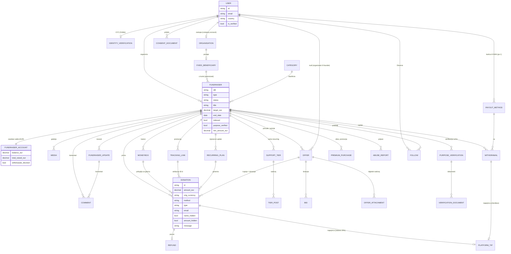

# 4fund.com: javni pregled funkcija, procesa i podatkovnog modela (24. 11. 2026.)

Pregled javnog dijela stranice https://4fund.com (europska inačica poljske platforme Zrzutka.pl;
interno je zovemo „forfund"). Cilj nije brand nego **što platforma radi**: uloge, vrste
prikupljanja, stranica kampanje, tok uplate, isplata, naknade, otkrivanje, moderacija i iz toga
izveden domenski model za našu hrvatsku P2P crowdfunding platformu koja plaća preko MPT raila
(SEPA → Monerium/Swan) umjesto kartica.

**Metoda.** Stranice su dohvaćene firecrawlom 24. 11. 2026. (engleska inačica; rute **bez**
jezičnog prefiksa rade, `https://4fund.com/en/...` vraća Cloudflare grešku 1101 ili 404).
Ništa nije poslano: nijedan obrazac, uplata ni registracija. Imena privatnih osoba s profila i
kampanja namjerno su izostavljena. Izvor je uz svaku činjenicu kao referenca, a popis URL-ova je
na dnu dokumenta. Kad se izvori međusobno razlikuju, to je navedeno. „Nije vidljivo javno” znači
da se iz javnog dijela ne može utvrditi.

**Ukratko (najvažnije za nas):**

- Operater je **Zrzutka.pl sp. z o.o.** (Wrocław), **nacionalna platna institucija** s licencom
  poljskog KNF-a br. **IP48/2019** (14. 10. 2019.), passportirana u cijeli EGP. Ona drži „račun
  prikupljanja” (zaseban platni račun po kampanji) i izvršava isplate i povrate; **naplatu donacija
  ne radi sama**, nego PayU S.A. i UAB ZEN.COM. [terms §2.7, §11][terms] [safety][safety]
- **Nema obavezne provizije.** Prihod: dobrovoljna napojnica platformi u checkoutu (**zadano 20 %**
  iznosa, klizač), dobrovoljna napojnica pri isplati, premium promocija (1–27 €), **0,50 € po
  povratu** uplate. [pay1][pay1] [costs][costs]
- **Isplata** organizatoru: bilo kad, i ako cilj nije dosegnut, na Visa/Mastercard karticu
  (Visa Direct / Mastercard Send, obično u minutama) ili na vlastiti EGP bankovni račun; jedna
  isplata najviše 20.000 €; potvrda kodom (e-mail/SMS). [faq-withdraw][faq] [terms Prilog 1 §6, §8][terms]
- **Verifikacija:** organizator mora biti punoljetan rezident EGP-a; obrazac (osobni podaci,
  dokument, PEP izjava) + Onfido (fotografija dokumenta + biometrija). **Svrha kampanje** se
  verificira dokumentima obavezno iznad **5.000 €** po kampanji ili **12.500 €** ukupno po
  organizatoru (isplate se tada automatski blokiraju), nakon prijave ili po procjeni rizika.
  [terms §3, §5][terms] [blog-verif][blog-verif] [blog-purpose][blog-purpose]

---

## 1. Što je 4fund

| Činjenica | Izvor |
|---|---|
| Operater: **Zrzutka.pl sp. z o.o.**, al. Karkonoska 59, 53-015 Wrocław, Poljska; VAT/NIP 8992796896, KRS 0000634168, temeljni kapital 550.000 PLN. | [costs][costs] (podnožje), [terms def. 29][terms] |
| 4fund.com je „dio Zrzutka.pl”; isti tim i ista tvrtka; Zrzutka.pl je vodeća poljska crowdfunding platforma; javne brojke (417 M €, 1,75 M kampanja, 22,6 M uplata) uključuju i zrzutka.pl, PLN preračunat u EUR. | [safety][safety], [home][home], [about][about] |
| Regulator: **Komisja Nadzoru Finansowego (KNF)**, dozvola od 14. 10. 2019., registar platnih institucija br. **IP48/2019**; prijavljeno prekogranično pružanje usluga u svim EGP državama (EU + IS, LI, NO), nijedan nadzornik nije prigovorio. | [safety][safety] |
| Primjenjuje KNF načela korporativnog upravljanja; nadzor AML/CFT po poljskom zakonu od 1. 3. 2018. | [costs][costs], [terms §12][terms] |
| Sredstva na računima kampanja zaštićena su po poljskom Zakonu o platnim uslugama (odvojena od vlastitih sredstava, ne mogu se ovršiti protiv operatera ni u stečaju); **ne nose kamatu**. | [terms §9.4, Prilog 1 §6.4][terms] |
| Naplatu donacija (payment initiation) pružaju treće strane: **PayU S.A.** (Poznań, KNF IP1/2012) ili **UAB ZEN.COM** (Vilnius); reklamacije na samu uplatu idu njima. Operater pruža samo: vođenje računa kampanje, isplate, povrate i „platni instrument” (sučelje stranice). | [terms §2.7, §14.4, Prilog 1 §6.1, §10.1][terms] |
| Identitetnu provjeru radi **Onfido Ltd.** (UK). | [terms §3.3][terms], [privacy][privacy] |
| Službeni e-mail samo s domena `@4fund.com` i `@mail4fund.com`. | [safety][safety] |
| Države organizatora: samo rezidenti **EGP-a** (sve EU države + IS, LI, NO). Uplatitelji: „iz bilo kojeg dijela svijeta”. | [terms §2][terms], [faq][faq] (can-i-donate-from-abroad) |
| Jezici: `hreflang` za 30 jezika (bg, ca, cs, da, de, el, en, es, et, fi, fr, ga, gl, **hr**, hu, is, it, lt, lv, mt, nl, no, pl, pt, ro, sk, sl, sv, tr, uk); opisi kampanja strojno prevedeni s gumbom „Show original … text”; blog navodi „automatski prijevod na 27 jezika”. Jedina izvorna verzija Uvjeta je engleska. | [home][home] (raw HTML), [camp1][camp1], [blog-ngo][blog-ngo], [terms §16.10][terms] |
| Valuta: računi kampanja vode se **isključivo u EUR**; uplatitelj može platiti u drugoj valuti (Apple Pay, Google Pay, kartica), partner preračunava u EUR. Ponuđene valute na checkoutu: EUR, USD, GBP, PLN, CHF, CZK, NOK, SEK, DKK, RON, HUF i „sve dostupne valute”. | [terms §4.12][terms], [pay1][pay1] |
| Postoji PWA u Google Play/App Store kao drugi kanal do istog weba. | [terms §16.12][terms] |
| Tim „više od 50 ljudi”, „13+ godina iskustva”. | [about][about], [media][media] |

## 2. Uloge i računi

### 2.1 Uloge (definicije iz Uvjeta)

| Uloga | Opis | Izvor |
|---|---|---|
| User | svaka punoljetna osoba koja koristi stranicu | [terms def. 26][terms] |
| Registered User | ima račun (ime, prezime, e-mail potvrđen kodom, lozinka) | [terms def. 22, §3.1][terms] |
| Verified User | prošao identitetnu verifikaciju (§3.3) | [terms def. 28][terms] |
| Organiser | korisnik koji je otvorio kampanju; vlasnik svih sredstava na računu kampanje | [terms def. 17, §2.6][terms] |
| Supporter | korisnik koji uplaćuje donaciju | [terms def. 25][terms] |
| Beneficiary | osoba (fizička ili pravna) u čiju korist ide kampanja, a nije organizator; **nema pravo** tražiti isplatu izravno sebi | [terms def. 4, „In brief” §6][terms] |
| Fixed Beneficiary | verificirana organizacija na popisu; kampanje u njezinu korist isplaćuju se **izravno na njezin račun** | [terms def. 10, §4.20–4.24][terms] |
| Founder | verificirani korisnik koji na tuđoj kampanji nudi „Founder's Offer” (prodaje predmet, novac ide kampanji) | [terms def. 11–12, §8.16–8.24][terms] |
| Donation Box's Organiser | registrirani korisnik koji je otvorio „kasicu” za tuđu kampanju; **ne treba verifikaciju**, nema pristup novcu | [terms def. 6–7, §4.15–4.19][terms], [hiw-moneybox][hiw-moneybox] |
| Content Creator | organizator kojemu platforma na zahtjev dodijeli status (kreativni, umjetnički, edukativni rad); daje licencu na ime, logo i lik za katalog kreatora | [terms def. 3, §4.25–4.29][terms] |

### 2.2 Fizička osoba

- Registracija: e-mail, lozinka (≥ 8 znakova, veliko i malo slovo, znamenka ili specijalni znak),
  prihvat uvjeta i privatnosti, opcionalno newsletter; potvrda e-maila brojčanim kodom. Postoji i
  „Continue with Facebook / Google”. [signup][signup] [terms §3.1, def. 19][terms]
- Jedna osoba = jedan račun; nema dijeljenih računa ni prijenosa; neograničen broj kampanja.
  [terms „In brief” §2][terms]
- Organizator se ne može promijeniti na drugu osobu; osnovni podaci moraju odgovarati obrascu,
  kartici i dokumentu. Promjena e-maila samo preko podrške. [faq][faq] (change-the-organiser, change-email)
- Postavke profila: slika, kratki bio, web; telefon; vidljivost na javnom profilu (e-mail,
  telefon, datum registracije, vrste kampanja, slika, ukupno prikupljeno); indeksiranje profila u
  tražilicama; metoda autentifikacije (6-znamenkasti kod e-mailom ili SMS-om, vrijedi 5 min);
  dnevni limit isplate; računi za premium usluge; brisanje računa samo uz saldo 0. [faq][faq]
- Javno se prikazuju ime, prezime (ili naziv organizacije) i država boravka. [blog-verif][blog-verif]

### 2.3 Verifikacija fizičke osobe (KYC)

Koraci [blog-verif][blog-verif] [faq][faq] (how-can-i-verify-my-profile):

1. Profil → „Account verification” → „Account for natural person”.
2. Identifikacijski obrazac: ime, prezime, državljanstvo, država rođenja, datum rođenja, OIB-ekvivalent
   (u Poljskoj PESEL; FAQ spominje „personal identification number” i adresu), vrsta dokumenta, serija i broj,
   datum isteka, država boravka (mora biti EGP). Nakon spremanja **ne može se mijenjati**. [b-orgaccount][blog-org]
3. PEP izjava (politički izložena osoba). Pogrešno označen PEP otključava podrška.
4. Onfido: fotografija osobne (obje strane), putovnice ili dozvole boravka (EGP), selfie video
   (liveness); „Continue on phone” preko QR koda ili upload fotografije (ne skenova ni fotokopija).
5. Ako se podaci podudaraju, verifikacija je automatska „u nekoliko minuta”; inače ručni pregled.

Uvjeti: ≥ 18 godina, rezident s EGP dokumentom. Razlozi odbijanja: nepodudaranje podataka, istekli
ili nepodržani dokument, loša slika ili video. [faq][faq] (why-was-my-account-verification-rejected)

**Nesklad izvora o tome kada kampanja smije primati uplate:** FAQ kaže da se nakon ispunjenog
identifikacijskog obrasca kampanja aktivira na **30 dana** u kojima ljudi mogu uplaćivati, a Onfido
dio treba dovršiti za isplate i nastavak kampanje [faq][faq] (can-people-donate-before-i-verify).
Blog i Uvjeti kažu da je za primanje donacija potrebna dovršena verifikacija [blog-verif][blog-verif]
[terms §2.4][terms]. Za isplatu treba i dodijeljena kartica ili bankovni račun. [terms §2.4][terms]

### 2.4 Pravna osoba / organizacija (company application)

Stranica „Company/Organisation registration”, 5 koraka [company][company]:

1. **Sign Up** e-mailom organizacije (postojeći privatni račun ne može se pretvoriti, treba novi). [blog-org][blog-org]
2. **Verification** zastupnika kao fizičke osobe (isti KYC kao 2.3).
3. **Company form**: naziv, web, pravni oblik, opis organizacije, opis projekta, procijenjeni
   mjesečni broj uplata, država, linkovi na društvene mreže (e-mail se popunjava sam). [blog-org][blog-org]
4. **Completing of the process**: podrška ručno pregleda zahtjev i „ako je moguće” vodi kroz promjenu
   vrste računa; traži dokumente ovisno o vrsti organizacije. Rok: **2 radna dana** ako je sve ispravno. [faq][faq]
5. (opcionalno) **Become a Fixed Beneficiary**: dodati račun za isplatu, prijaviti se u
   postavkama („Become a Fixed Beneficiary”); dobiva landing stranicu, gumb „Create fundraiser for
   the organisation” na profilu i mjesto u katalogu organizacija. [blog-ngo][blog-ngo] [faq][faq]

Uvjeti se izravno primjenjuju samo na fizičke osobe; za pravne osobe operater „može odlučiti”
otvoriti račun i urediti odnos posebnim ugovorom. [terms „In brief” §2][terms]
Predlošci: punomoć zaposleniku za upravljanje profilom organizacije, izjava o stvarnom
vlasništvu, PEP izjava, izjava o izvoru imovine (samo PL). [faq][faq] (document-templates)

### 2.5 Profili

- Osobni profil `/profile/{slug}`, profil organizacije `/profile/{id}` (16 znakova): naziv, opis,
  broj donacija, datum pridruživanja, web, „Send message”, tabovi „Private fundraisers” i
  „Fundraisers on behalf of the organisations”, gumbi „Donate {organizacija}” i „Create fundraiser
  for the organisation”. [orgprofile][orgprofile]
- Na kampanji uz ime organizatora piše država i oznaka „Profile verified”. [camp1][camp1]
- Ruta `/{lang}/o/{org}` postoji u mapi stranice; sadržaj nije provjeren. [rute][rute]

## 3. Vrste prikupljanja i namjene

### 3.1 Tri tipa kampanje (izbor na prvom koraku stvaranja)

| Tip | Bit | Izvor |
|---|---|---|
| **One-time / Regular fundraiser** (`type=default`) | jednokratne uplate, isplata na račun organizatora | [create][create], [hiw][hiw] |
| **Recurring fundraiser** (`type=recurring`) | uz jednokratne i mjesečne uplate karticom; prikaz „monthly” + „total”, kotač napretka; razine podrške (support tiers) | [recurring][recurring], [faq][faq] |
| **Fundraiser for organisation** (`type=patronized`) | organizator prikuplja za Fixed Beneficiary; novac ide izravno organizaciji; organizacija mora odobriti kampanju prije uplata | [patronized][patronized], [blog-ngo][blog-ngo] |

Promjenu tipa (jednokratna ↔ ponavljajuća, jednokratna → za organizaciju) radi samo podrška. [faq][faq]

### 3.2 Kategorije

- Pri stvaranju („What best describes the purpose”): **Charity, Culture, Projects, Needs, Sport,
  Animals, Travels, Other**. [create][create]
- Katalog organizacija: All, Charity, Projects, Needs, Sport, Culture, Animals, Travel. [patron][patron]
- Marketinške namjene: „For yourself” (Project, Gift, Medical Treatment, Animals, Your Idea);
  „For family and friends” (Gift, Fire, Medical Treatment, Your Idea). [hiw][hiw] [hiw-family][hiw-family]
- Kampanja za drugu osobu traži **pisanu suglasnost korisnika** prije početka (osim rođendanskih
  poklona) + sken njegove osobne. [hiw-family][hiw-family] [terms §4.8][terms]

### 3.3 Dodatni mehanizmi

| Mehanizam | Kako radi | Izvor |
|---|---|---|
| **Offers / „Buy now”** | organizator (verificiran) nudi predmet, uslugu ili digitalni sadržaj za minimalni iznos donacije; kupac može platiti i više; ugovor o prodaji je između organizatora i kupca; kontakt za dostavu ≤ 7 dana | [terms §7, §8.1–8.5][terms] |
| **Auctions** | licitiraju samo prijavljeni; ponude ≥ 2.500 € samo verificirani; ponude se ne mogu povući; pobjednik ima **24 h** za uplatu, inače organizator može prodati sljedećem; e-mail kad netko nadmaši i 1 h prije kraja | [terms §8.6–8.8][terms], [faq][faq] |
| Polja ponude | naslov, opis, kategorija, stanje (novo/rabljeno), slike, način (Buy now/Auction), cijena, količina, trajanje, dostava (osobno, pošta, e-mail), privitci za digitalno, telefon | [faq][faq] (how-to-add-rewards) |
| **Digital Offers** | privitak se preuzima s kampanje odmah po uplati; link i e-mailom | [terms def. 5][terms], [blog-rewards][blog-rewards] |
| **Posts for offers** | ekskluzivni sadržaj vezan uz ponudu, dostupan kupcu 30 dana | [faq][faq], [blog-advanced][blog-advanced] |
| **Founders' Offers** („Support by selling”) | treća osoba (verificirana, nije poslovno) nudi predmet na tuđoj kampanji ako organizator to dopusti; organizator prihvaća ili odbija; novac ide na račun kampanje | [terms §8.16–8.24][terms], [hiw-sell][hiw-sell] |
| **Donation Box / Moneybox** | „kasica” = kopija kampanje s vlastitim naslovom, opisom, adresom, zahvalom, brojačem i popisom uplata; novac ide na račun glavne kampanje; nije zasebna kampanja ni platna usluga; organizator je može isključiti | [terms §4.15–4.19][terms], [hiw-moneybox][hiw-moneybox] |
| **Support tiers** (samo recurring) | razine s naslovom, iznosom, opisom; postovi „za svaku razinu” ili „za ovu i više”; pristup traje dok je pretplata aktivna + 32 dana (ili 32 dana od jednokratne uplate tog iznosa); razina se ne smije obrisati nakon prve kupnje | [terms §7.9–7.12][terms], [faq][faq] |
| **Content Creator** status | na zahtjev ili ponudu platforme; odbija se za pornografiju, „trash streaming”, kockanje, lažne vijesti, mržnju | [terms §4.25–4.29][terms] |
| **Awards / Offers catalog** | globalni katalog ponuda i aukcija (vidi 8.3) | [awards][awards] |
| **DAC7** | operater je „platform operator” po Direktivi (EU) 2021/514; tko nudi Offers mora dati porezni broj (TIN) i adresu; bez toga se nakon 60 dana blokiraju isplate s takvih kampanja i brišu ponude | [terms §8.25–8.32][terms] |

## 4. Kampanja: polja, stranica, životni ciklus

### 4.1 Stvaranje (wizard)

`/fundraiser/create/choose-type` → `/fundraiser/create/set-goal?type=…`, koraci [setgoal][setgoal] [create][create]:

1. Odabir tipa i kategorije.
2. Naslov (**max 60 znakova**, gumb „Improve”, AI pomoć pri opisu postoji po Uvjetima §4.4) + ukupni iznos u EUR.
3. Fotografije ili video (prva stavka galerije je naslovnica; preporuka ≥ 750 × 420 px; video samo URL s YouTube/Vimeo).
4. Opis.
5. Pregled.

Obavezno je naslov, opis i ciljni iznos; slike i ponude opcionalno. [terms §4.1][terms]
Iznad 35.000 € opis mora sadržavati okvirni troškovnik s prioritetima i namjenu viška. [terms §4.5][terms]

### 4.2 Polja i postavke koje organizator uređuje

Iz FAQ-a [faq][faq] (sekcija „Editing / Managing the fundraiser”) i Uvjeta:

| Polje / postavka | Napomena |
|---|---|
| Naslov („Fundraiser goal”), ciljni iznos („Target amount”), kategorija, datum završetka („End date”) | uređuje se preko „Edit” |
| Opis (editor sa slikama, videom, linkovima) | nakon verifikacije svrhe ili kupljene promocije može biti zaključan [faq][faq] [blog-purpose][blog-purpose] |
| Galerija (upload, crop, rotacija, redoslijed; video preko URL-a) | |
| Lokacija (pretraga ili pin na karti) | koristi se u pretrazi po lokaciji |
| Minimalni iznos uplate („Amount per user”, EUR) | globalni minimum je 1 € [terms §4.11][terms] |
| Vidljivost u katalogu i tražilicama (checkbox) | „privatna” kampanja i dalje je dostupna s linkom |
| Sakrij prikupljeno i ciljni iznos | |
| Sakrij broj donatora | |
| Postavke donacija: sortiranje (iznos/datum), sakrij iznose, sakrij imena, dopusti ponavljajuće | |
| Komentari: isključeni / samo donatori / svi | isključivanje skriva i stare komentare [terms §16.5][terms] |
| Personalizirana zahvala za donaciju („Edit basic information”) | i za kasice |
| Dopusti kasice; dopusti tuđe ponude (Founders' Offers) | |
| Obavijesti o novim donacijama (on/off) | |
| Facebook Pixel, Google Analytics | [hiw][hiw], [privacy][privacy] |

Svrha i korisnik **ne smiju se mijenjati nakon prve uplate**; opis se smije samo dopunjavati.
Višak iznad cilja: namjena što bliža izvornoj, uz dogovor s platformom. [terms §4.6–4.7][terms]

### 4.3 Javna stranica kampanje (struktura viđena na dvije kampanje)

Redoslijed elemenata [camp1][camp1] [camp2][camp2]:

- Galerija (`1/9`), **ID** kampanje (6 znakova, npr. `id: 72wbb3`; URL `4fund.com/{id}`) [faq][faq]
- Naslov; organizator (ime, država, „Profile verified”); oznaka „Verified fundraiser” ako je svrha verificirana
- Sidra/tabovi: Updates (broj), Description, Donation boxes (broj), Donations (broj), Comments (broj)
- Brojke: prikupljeno, od cilja, postotak, „N days till end”, broj donatora; za recurring „€ monthly” + „€ total”
- Gumbi: **Donate** (`/{id}/pay`; za recurring „Donate your way”), **Share**, **Create donation box**
  (`/{id}/add-moneybox`), **Observe** (praćenje e-mailom: komentari, novosti, kraj kampanje)
- „Promotional materials”: Poster, QR code, Widget, Streaming widget (novo), Statistics
- Obavijest „report this fundraiser using the form”
- Oznaka strojnog prijevoda + link na izvorni jezik (`/hu/{id}`)
- **Updates** (datum, tekst, slike/video; komentari i na novostima)
- **Description** („Read more”)
- Share blok („5 times more”), kopiranje linka
- Recurring: blok „Benefits of a recurring donations”, razine podrške
- **Donation boxes** (naslov, iznos, %, broj donatora, autor; URL `/s/{alias}`)
- **Donations**: sortiranje „Latest / Highest”; red = vrijeme, ime ili „Hidden data”, iznos ili „hidden”
- **Comments**: do **2.500 znakova**; komentar uz donaciju prikazuje iznos; odgovori organizatora; „Anonymous user”
- Ponude/aukcije (sekcija „Offers/Auctions” ispod opisa) [faq][faq]

### 4.4 Alati za širenje i statistiku

| Alat | Detalji | Izvor |
|---|---|---|
| Share | Facebook, LinkedIn, Twitter, Messenger, e-mail, kopiranje linka | [hiw-share][hiw-share] |
| **Tracking link** | `4fund.com/z/{slug}` (vlastiti ili „Random”), više po kampanji; statistika na `…/z/{slug}+`: posjeti, broj i iznos donacija; atribucija **30 dana** po pregledniku/uređaju; posjet se broji jednom u 10 min; pri ulasku URL se vraća na osnovni | [blog-tracking][blog-tracking], [faq][faq] |
| QR kod | na kampanju ili izravno na uplatu | [faq][faq], [blog-advanced][blog-advanced] |
| Poster | generira se jednim klikom; „greeting card” s popisom donatora | [blog-advanced][blog-advanced] |
| Widget | HTML kod, veličina i izgled, cilj klika = kampanja ili uplata; može ga ugraditi bilo tko, bez računa | [blog-widget][blog-widget] |
| Streaming widget | overlay za OBS/Streamlabs: napredak, obavijesti o donacijama, ljestvica donatora, QR | [faq][faq] |
| Alias (premium) | `4fund.com/{naziv}` | [costs][costs], [faq][faq] |
| Izvoz donacija | „Finances” → „Export XLS”: iznos, način plaćanja, e-mail, ostali podaci, i za anonimne | [faq][faq] |
| E-mail donatorima | dopušteno po politici privatnosti III.3.3 (zahvala, napredak, obračun, druge kampanje); premium „delegiraj zahvale” od 50 donatora | [blog-donorcomm][blog-donorcomm] |

### 4.5 Životni ciklus

| Stanje | Opis | Izvor |
|---|---|---|
| Nacrt / u izradi | wizard; „My fundraisers” | [setgoal][setgoal] |
| Čeka odobrenje organizacije | samo `patronized`; do odobrenja nema uplata; organizacija može odbiti → kampanja se briše | [blog-ngo][blog-ngo], [terms §4.21][terms] |
| Aktivna | prima uplate; **ostaje aktivna i nakon datuma završetka** (nestaje samo odbrojavanje), rok se može produžiti | [faq][faq] |
| Neindeksirana / privatna | isključena vidljivost u katalogu, ili profil neverificiran, ili nema opisa | [cdp][cdp] |
| Isplate blokirane | verifikacija svrhe u tijeku (automatski na 5.000 / 12.500 €), prijava, sumnja | [terms §5.6][terms] |
| Privremeno blokirana | sporni opis (rok za ispravak), smrt korisnika ili nemoguća svrha (organizator bira povrat ili novu svrhu uz 14 dana za povrate) | [terms §4.3, §4.9][terms] |
| Isključena („Turn off”) | vidljiva, ne prima uplate; može se ponovno uključiti | [faq][faq] |
| Obrisana | nevidljiva, ne može se vratiti; brišu se i kasice | [faq][faq], [terms §4.19][terms] |
| Zaustavljena uz povrat | npr. 14 dana bez dokumenata za verifikaciju → povrat donatorima do salda | [terms §5.8][terms] |

## 5. Tok uplate (`/{id}/pay`)

Viđeno na jednokratnoj [pay1][pay1] i ponavljajućoj kampanji [pay2][pay2]. Ništa nije poslano.

1. Zaglavlje: organizator, država, „Profile verified”; „Go back”.
2. **Valuta**: EUR, USD, GBP, PLN, CHF, CZK, NOK, SEK, DKK, RON, HUF, „Show all available currencies”.
3. **Iznos**: predlošci (jednokratna: 1.000 / 500 / 300 / 100 / 70 / 50 / 20 €, „Most popular” na 100;
   recurring: 200 / 100 / 50 / 30 / 20 / 10 / 5 €, „Most popular” na 30) + „Other amount”. Minimum 1 €. [terms §4.11][terms]
4. **Način plaćanja**: jednokratna prikazuje „Pay by Visa or Mastercard” i proširivi popis; recurring
   ima prekidač **Single / Recurring** („Support monthly. You can cancel at any time.”) s Apple Pay,
   Google Pay i karticom. Popis metoda po FAQ-u: Visa, Mastercard, Apple Pay, Google Pay, Revolut, ZEN,
   iDEAL, Bancontact, Multibanco, MB WAY, N26, Skrill, EPS; stranice „how it works” spominju i Sofort.
   **PayPal nije podržan** („da platforma ostane besplatna”). [faq][faq] [hiw-donate][hiw-donate]
5. **„Support 4fund.com team”**: dobrovoljna naknada platformi, **zadano 20 %** donacije, klizač s
   oznakama 0 % i 30 %; tekst: pokriva operativne troškove i „provizije vanjskih operatera”.
   Uvjeti zabranjuju organizatoru da potiče donatore da ne daju napojnicu. [pay1][pay1] [terms §4.3][terms]
6. **Dodatne postavke**: sakrij moje podatke na javnom popisu; sakrij iznos; poruka organizatoru
   (max 300 znakova) + „prikaži poruku u komentarima”; e-mail obavijesti o novostima kampanje i newsletter.
7. **Sažetak**: e-mail (obavezan), ime i prezime (opcionalno u sučelju; Uvjeti kažu „trebaš navesti”),
   „Donate as a company”.
8. **Ukupno**: „Organiser will receive €X”, „Support for the 4fund.com team €Y”, „Total donation €X+Y”
   (recurring: „monthly”).
9. Prihvat Uvjeta i privatnosti (recurring i PayU uvjeta jednokratne transakcije) → „Donate €…”.
   Napomena o PSD2 SCA na stranici banke. [pay2][pay2]

Nakon uplate:

- Knjiženje na kampanju „gotovo odmah, obično do 5 minuta”. [faq][faq]
- Potvrda e-mailom; uplata na javnom popisu (osim ako je skrivena); prijavljeni korisnik može
  preuzeti **PDF potvrdu** („Donated by me” → „Download confirmation PDF”). [faq][faq]
- Potvrda za porezni odbitak za uplate „Public Benefit Organisations” (organizacijama javne koristi). [hiw-donate][hiw-donate]
- Registracija nije potrebna za jednokratnu uplatu; **ponavljajuća traži prijavu** (otkazivanje u
  „Settings → Recurring payments”). [terms §4.11, §7.1, §7.8][terms]
- Ponavljajuća: PayU tokenizira karticu; napojnica platformi se također ponavlja; neuspjela naplata
  se po Uvjetima preskače do sljedećeg mjeseca, po FAQ-u se pokušava 3 dana zaredom. [terms §7.4–7.7][terms] [faq][faq]
- Donator ne može sam otkazati uplatu: povrat traži od organizatora („Ask the Organiser a question”);
  napojnicu platformi može tražiti natrag od podrške. [faq][faq]
- Chargeback snosi organizator (odbija se sa salda kampanje ili njegovih drugih kampanja). [terms §4.10][terms]

## 6. Isplata organizatoru

| Pitanje | Odgovor | Izvor |
|---|---|---|
| Kada | bilo kada, koliko često želi, **i kad cilj nije dosegnut** (keep-it-all) | [faq][faq] |
| Preduvjeti | verificiran račun + dodijeljena Visa/Mastercard kartica (podrška za Visa Direct / Mastercard Send) **ili** vlastiti bankovni račun u EGP banci | [terms §2.4, §4.13–4.14][terms] |
| Verifikacija kartice | unos na sigurnoj stranici + mala terećenja koja se vraćaju; kartica mora glasiti na organizatorov račun; 1 kartica naraz, najviše 3 promjene u 30 dana | [terms §4.13][terms] |
| Verifikacija bankovnog računa | opcija „Bank Transfer (EURO)”: uplata 0,10 € s tog računa po uputama na ekranu (vraća se); 1 račun naraz | [terms §4.14][terms] |
| Proces | „Withdraw funds” → kampanja → „Pay out” → iznos i podaci → potvrda kodom (e-mail/SMS); uz isplatu checkbox dobrovoljne napojnice platformi | [faq][faq], [costs][costs] |
| Trajanje | na karticu obično u minutama; na bankovni račun „nekoliko radnih dana”; zajamčeni rok: kraj sljedećeg radnog dana | [faq][faq], [terms Prilog 1 §8][terms] |
| Limiti | najviše **20.000 €** po isplati; korisnik postavlja vlastiti dnevni limit | [terms Prilog 1 §6.10][terms], [faq][faq] |
| Valuta | samo EUR; tečaj banke ako je račun u drugoj valuti | [terms Prilog 1 §6.9][terms] |
| Javnost | isplate se **ne prikazuju** na kampanji; javni ukupni iznos se ne smanjuje | [faq][faq] |
| SCA | kod potreban i za: dodavanje „trusted recipient”, povrate, verifikacijski tab, povijest isplata (prvi put, > 90 dana) | [terms Prilog 1 §6.8][terms] |
| Blokade | automatski iznad 5.000 € (kampanja) ili 12.500 € (svi); verifikacija u tijeku; prijava; sumnja na prijevaru (i na ostalim kampanjama); DAC7 podaci; ovrha (novac ide ovršitelju) | [terms §5.6, §8.29, §16.4][terms] |
| Za organizaciju (Fixed Beneficiary) | „Payout” u „My fundraisers” šalje sve **izravno na račun organizacije**; ako organizator odugovlači, organizacija može tražiti isplatu bez njega | [terms §4.20][terms], [blog-ngo][blog-ngo] |
| Prije brisanja računa | saldo mora biti 0 (isplatiti ili vratiti) | [terms §10.1][terms] |
| Smrt organizatora | privatna svrha: blokada do nasljednika; za korisnika: isplata korisniku | [terms §16.7][terms] |

**Povrati (refunds):** organizator može vratiti pojedinačne uplate ili cijeli saldo („Finances” →
odabir → „Return selected”) i bira tko plaća **0,50 € po povratu** (organizator ili donator); povrat ide
na karticu ili račun s kojeg je uplaćeno, u EUR; kad saldo nije dovoljan, vraća se od najnovije uplate
prema starijima, zadnja djelomično. [faq][faq] [terms §11][terms] [costs][costs]

## 7. Troškovi i poslovni model

Doslovno sa `/costs` [costs][costs] i iz Uvjeta [terms Prilog 1 §11][terms]:

- „Setting up and using an account on 4fund.com is **100% FREE for everyone**”; **nema provizije na
  uplate ni isplate**; donatori ne plaćaju naknadu „bez obzira na način plaćanja”.
- Operater **sam pokriva naknade PayU i ZEN.COM** za uplate, a umjesto naknade traži od donatora i
  organizatora **dobrovoljnu zasebnu donaciju** platformi (u checkoutu klizač, zadano 20 %; pri isplati
  checkbox; uz podsjetnik „No, thank you”).
- Premium usluge (jedine obavezne naknade; iznosi bruto):

| Usluga | Trajanje | Cijena |
|---|---|---|
| Individualna adresa (alias) | 7 / 14 / 30 dana | 1 / 2 / 3 € |
| Promovirana kampanja (**„Coming soon”**) | 7 / 14 / 30 dana | 5 / 10 / 15 € |
| Isticanje promovirane (**„Coming soon”**) | 7 / 14 / 30 dana | 8 / 16 / 24 € |
| Paket (alias + promocija + isticanje) (**„Coming soon”**) | 7 / 14 / 30 dana | 9 / 18 / 27 € |

- Premium (osim aliasa) traži prethodnu **verifikaciju svrhe** dokumentima; platforma može odbiti
  oglašavanje (drastično, sporno, sudski postupci) i vratiti naplaćeno. Plaća se iz salda kampanje ili
  online. [terms §6][terms] [faq][faq]
- **Naknada za povrat: 0,50 € po transakciji.** [costs][costs]
- Ostali izvori koje stranica spominje: premium „delegirane zahvale” od 50 donatora; Facebook
  remarketing oglasi („Promote”). [blog-donorcomm][blog-donorcomm] [faq][faq]
- Fakture samo za premium (uključiti „I want to receive invoices” unaprijed); za donacije se ne izdaju. [faq][faq]
- Porezi: „ne dajemo porezne savjete”; porezne obveze snosi organizator. [faq][faq] [terms „In brief” §5][terms]

## 8. Marketplace i otkrivanje

### 8.1 Katalog kampanja (`/catalog`)

- Prikazuju se samo **indeksirane** kampanje: organizator verificiran, opis postoji, indeksiranje
  nije isključeno. Pretraga po ključnim riječima u naslovu i opisu. [cdp][cdp]
- Filtri u sučelju: Countries, Types, Fundraise categories, Location, More filters. [catalog][catalog]
- URL parametri (otkrivaju model filtara): `term`, `categories`, `countries`, `recurring`, `patronized`,
  `awarded` (ima ponude), `chipBox` (ima kasice), `verified`, `ongoing`, `ending`, `successful`,
  `almostSuccessful`, `dateCreated`, `gathered`, `paidIn`, `glat`/`glng`/`radius` (zadano 10), `sort`, `page`. [catalog][catalog]
- Vrste prikaza: sve, samo promovirane, samo verificirane. [cdp][cdp]
- Sortiranje: Popular Today (iznos u zadnja 24 h), Most Funds (zadano), Least Funds, Newest, Oldest,
  Ending Soon, Based on Latest Updates; jednaki rezultati po datumu nastanka. Kod „samo promovirane”
  prvo idu kupljena isticanja. Nema drugih kriterija rangiranja (deklarirano, DSA-stil transparentnost). [cdp][cdp]
- Kartica u katalogu: država, naslov, iznos, cilj, %, dani do kraja; recurring „monthly / total / donors”. [catalog][catalog]

### 8.2 Naslovnica

- „Extraordinary/Remarkable Fundraisers”: ručni izbor tima, bez plaćanja; uvjet: indeksirana, prima
  uplate, ima fotografiju; osvježava se svakih 10 minuta. [cdp][cdp] [home][home]
- Brojači (kampanje, uplate), „Crowdfunding Donations Map” po državama, uživo „donacije u zadnjih 30 dana”,
  priče o uspjehu, Trustpilot, poziv na katalog ponuda. [home][home]

### 8.3 Katalog ponuda i aukcija (`/awards/catalog`)

- Filtri: vrsta prodaje (Auctions / Buy now), tip nagrade (All / Bestsellers), ~15 kategorija s
  potkategorijama (za djecu, moda, knjige, umjetnost, dom i vrt, ljepota, ulaznice i vaučeri, autogrami,
  sport/hobi/turizam, elektronika i glazba, svakodnevna kupnja, pretplate, donacije i zahvale, susreti, ostalo),
  stanje (novo/rabljeno), cijena (rasponi + od–do), lokacija (grad), „uskoro završava”. [awards][awards]
- Sortiranje: Popular (kupnje u zadnja 3 dana), Most expensive, Cheapest, Newest, Oldest. [cdp][cdp]
- Kartica: kategorija • potkategorija, opis, cijena, „Available N pcs.”. [awards][awards]
- Odabir kampanje za Founder's Offer: lista kampanja koje to dopuštaju, po prikupljenom iznosu. [cdp][cdp]

### 8.4 Katalog organizacija (`/patron-catalog`) i kreatora

- Kartice organizacija (naziv, kratki opis, link na profil), filtar po kategoriji, „Load more”;
  CTA „Create a fundraiser for the organisation”. [patron][patron]
- `/creators/catalog` i `/creators` vraćaju **404** u trenutku pregleda; status Content Creatora i
  „katalog kreatora” postoje u Uvjetima. [creators][creators] [terms §4.28][terms]

## 9. Sigurnost, moderacija, zabranjeni sadržaj, prijave

**Zabranjene svrhe** [terms §4.2, „In brief” §4][terms]: protuzakonito u državi organizatora ili u
Poljskoj (posebno: kazne i jamčevine u kaznenom postupku); mržnja, nasilje, diskriminacija, terorizam,
totalitarizam; kleveta (pravni troškovi dopušteni, tvrdnje treba dokazati); oružje; kockanje,
prostitucija, pornografija; dezinformacije; udjeli u tvrtkama ili donacije kao zajmovi (nije equity
platforma); prikrivena naplata robe/usluga; paravojne organizacije; potpora Ruskoj Federaciji i
sankcioniranim područjima; projekti bez potrebne dozvole; spam; alkohol, duhan, droge. Dodatno:
**kripto svrhe** se ne dopuštaju gdje nije moguć dubinski AML pregled; pomoć područjima zahvaćenim
ratom traži **prethodnu suglasnost** platforme. [terms §12.3–12.4][terms]
Kampanja ne smije služiti kao osobni novčanik ni za „vrćenje prometa” radi bankovnih promocija. [terms §16.6][terms]

**Sadržaj:** organizator mora imati prava na sve fotografije; zabranjen pogrdan jezik, prazan ili
nerazumljiv opis. [terms „In brief” §4, §4.3][terms]

**Moderacija komentara** (DSA-oblik) [terms §15][terms]: zaposlenici provjeravaju komentare; brišu
nezakonito i niz kategorija (linkovi, oglašavanje, konkurencija, mržnja, uvrede, vulgarnosti…);
vulgarizmi i linkovi na crowdfunding kampanje uklanjaju se **automatski**; prijava nezakonitog
sadržaja obrascem → odluka ≤ 14 dana, obavijest prijavitelju; autor može uložiti žalbu u 14 dana,
odluka o žalbi ≤ 14 dana; prijava policiji kod prijetnje životu; kontakt točka za tijela EU.

**Prijave kampanja:** gumb/obrazac „Report abuse” na svakoj kampanji; svaka ozbiljna prijava pokreće
verifikaciju i **blokadu isplata** do završetka; potvrđene prijevare prijavljuju se tijelima, a saldo
vraća donatorima (bez odgovornosti za već isplaćeno). [terms „In brief” §5][terms] [faq][faq]

**Verifikacija svrhe** (detalji) [terms §5][terms] [blog-purpose][blog-purpose] [faq][faq]:

- Obavezna: nakon prijave, po procjeni rizika, kampanja > 5.000 €, organizator > 12.500 € ukupno;
  dobrovoljna za dobivanje oznake vjerodostojnosti i za premium.
- Pokretanje e-mailom; upload u „Settings → Verify fundraisers” ili na dnu kampanje u uređivanju.
- Vrste dokumenata: medicinski (organizator, osoba na skrbi, druga osoba) ili ostali; JPG/JPEG/GIF/PDF/PNG,
  ≤ 20 MB, ≤ 10 datoteka po slanju; jezik engleski ili poljski (ili ovjereni prijevod).
- Primjeri: liječnička dokumentacija s pečatom i potpisom; veterinarska (ne screenshot); potvrda
  vatrogasaca/policije za požar ili nesreću; suglasnost organizacije; suglasnost korisnika + sken osobne.
- Rok za dokumente **14 dana**, inače zaustavljanje i povrat; pregled do **2 radna dana**; jednom
  pokrenuta verifikacija ne može se odustati; nakon verifikacije naslov, opis i cilj su zaključani.
- Iznad 35.000 € cilja i 25.000 € isplaćenog moguće višekratne provjere potrošnje (računi, ugovori).

**Tehnička i podatkovna sigurnost:** sigurnost uplata i isplata „jamči PayU”; TLS; hashirane lozinke;
nadzor 24/7; dokumenti KYC u zasebnim mapama, zatim na šifriranim offline medijima. [safety][safety]
**Blokada računa:** suspenzija pri sumnji, brisanje i blacklisting; reputacijski rizik (npr. osuđene
osobe) je dovoljan razlog za odbijanje. [terms §10][terms]

## 10. Inventar ruta

Rute iz mape stranice [rute][rute] i dodatne viđene u pregledu. „Naša platforma” je prijedlog, ne odluka.

| Ruta | Što radi | Što bi naša platforma trebala imati |
|---|---|---|
| `/` (`/{lang}`) | naslovnica: tipovi kampanje, brojači, mapa donacija po državama, ručno birane kampanje, priče | naslovnica s 3 tipa, uredničkim izborom i brojačima iz našeg ledgera |
| `/how-it-works` = `/how-it-works/collect/for-yourself` | marketing: namjene, 3 koraka, tipovi, napredne funkcije | „Kako radi” za organizatore |
| `/how-it-works/collect/for-family-and-friends` | kampanja za drugog + korak „suglasnost korisnika” | isto, s predloškom suglasnosti na hrvatskom |
| `/how-it-works/support/donate` | kako donirati, metode, potvrde | „Kako donirati”: SEPA uplatnica/QR (EPC, HUB3 za HR IBAN), MPT checkout |
| `/how-it-works/support/buy` | kupnja/licitacija ponuda | faza 2 (ponude), vidi ograničenja ispod |
| `/how-it-works/support/sell` | Founders' Offers: prodaj za tuđu kampanju | faza 3 |
| `/how-it-works/support/share` | dijeljenje, widget, QR poster, tracking link | dijeljenje + tracking link od prvog dana |
| `/how-it-works/support/moneybox` | kasice (peer-to-peer podkampanje) | kasice: jeftino, velika vrijednost (timovi, razredi) |
| `/how-it-works/why-us` | brojke, studije slučaja | kasnije |
| `/costs` | naknade, napojnica, premium cjenik, 0,50 € povrat | javna stranica troškova; odluka o napojnici i cijeni povrata SEPA-om |
| `/faq` (+ `/faq/{kategorija}/{pitanje}`) | ~140 pitanja u 10 kategorija | FAQ po istoj podjeli |
| `/safety` | licenca, PSP, verifikacija, e-mail domene | stranica o MPT/Monerium/Swan modelu i tko drži novac |
| `/terms` (+ PDF) | uvjeti + okvirni ugovor o platnim uslugama + cjenik | uvjeti platforme; platni dio pokriva MPT/Monerium/Swan, ne mi |
| `/privacy` | GDPR, procesori (Onfido, PayU, Facebook Pixel…) | politika privatnosti, uklj. pravo organizatora na e-mail donatora |
| `/content-display-policy` | transparentnost rangiranja (DSA) | ista stranica, obavezno za DSA |
| `/ue-brochure` | link na EK brošuru o pravima potrošača u plaćanjima (čl. 20d poljskog ZPU) | link ako budemo platni subjekt; inače nije nužno |
| `/about-us`, `/media`, `/blog`, `/blog/{id}/{slug}`, `/feedback` | o nama, press kit, blog s kategorijama (crowdfunding, ideje, priče, promocija, savjeti), povratne informacije | blog i press kasnije |
| `/sign-up/user-data` | registracija (e-mail/lozinka, Facebook, Google) | registracija (magic link/passkey), bez društvenih login gumba na početku |
| `/company-application/steps` | 5 koraka za račun organizacije | onboarding udruge/tvrtke (OIB, zastupnik, IBAN) |
| `/catalog` | katalog kampanja s filtrima i sortiranjem | katalog (kategorija, županija/grad, tip, verificirano, sort) |
| `/awards/catalog` | katalog ponuda i aukcija | faza 2 |
| `/patron-catalog`, `/patronized-fundraising` | katalog organizacija + kampanje u ime organizacije | „prikupljaj za udrugu”: odobrenje udruge, isplata izravno na IBAN udruge (dobro se slaže s MPT forwardom) |
| `/creators/catalog` | katalog kreatora (404 u trenutku pregleda) | kasnije, uz recurring |
| `/recurring` | landing za mjesečne kampanje i razine | recurring kroz SEPA trajni nalog ili mjesečni podsjetnik, ne karticu |
| `/profile/{slug}`, `/o/{org}` | javni profil osobe ili organizacije | profili s postavkama vidljivosti |
| `/{id}` (6 znakova) | stranica kampanje | stranica kampanje (vidi 4.3) |
| `/{id}/pay` | checkout | checkout preko MPT intenta (`POST /v1/intents`), napojnica opcionalno |
| `/{id}/add-moneybox`, `/s/{alias}` | stvaranje i stranica kasice | isto |
| `/z/{slug}`, `/z/{slug}+` | tracking link i njegova statistika | isto |
| `/{alias}` | premium alias | slug kampanje besplatno |
| `/fundraiser/create/choose-type`, `/fundraiser/create/set-goal?type=` | wizard (tip, kategorija, naslov ≤ 60, iznos, mediji, opis, pregled) | wizard (već postoji skica u energy `novi-projekt`) |
| `/whip-rounds/add-awards` | dodavanje ponude („Become a donor”) | faza 3 |
| `/api/v1/public/doc` | javni read-only API (vidi ispod) | javni read API za kampanje i uplate + webhooks |
| `/third-party-account/connect/{facebook,google}/{lang}` | OAuth prijava | po potrebi |
| `/contact` | kontakt obrazac (za prijavljene) | kontakt |

**Javni API** [api][api] [faq][faq] (how-to-access-the-open-api): OpenAPI 3.0 (NelmioApiDocBundle), pristup
na zahtjev, dodjela `access_token` (`Authorization: Bearer …`), limit **10.000 zahtjeva/sat**, keš 1 s,
zaglavlje `X-ZRZUTKA-ACCEPT-LANGUAGE: en`. Samo GET:

- `GET /api/v1/public/whipRounds` (kampanje korisnika, kursor `after`)
- `GET /api/v1/public/whipRounds/{whipRound}`
- `GET /api/v1/public/whipRounds/{whipRound}/payments` (`after`, `email`, `createdSince`, `createdUntil`)
- `GET /api/v1/public/whipRounds/{whipRound}/moneyBoxes`
- `GET /api/v1/public/whipRounds/{whipRound}/moneyBoxes/{moneyBox}/payments`

Sheme: `ChipResponseModel` (id, subject{pl,en}, content{pl,en}, url, picture, minimumPaymentAmount,
amountToCollect, amountCollected, currency, paymentCount, dateEnds, created, projectedAmountFromAuctions);
`PaymentResponseModel` (id, name, isNameAnonymous, email, message, amount, isAmountAnonymous, currency,
type npr. `single`, prize{pl,en}, offerId, created); `MoneyBoxSummaryModel` (alias, title, url,
amountCollected, paymentCount, currency, created). Login, plaćanje, isplate, verifikacija, premium i
saldo **nisu** javni (samo licenciranim PSD2 subjektima). Interni nazivi: kampanja = „whip-round” /
„chip”, nagrada = „award/prize”.

## 11. Pretpostavljeni domenski model

Izveden iz Uvjeta, FAQ-a, stranica i API shema; nije njihova stvarna baza. Imena su naša.

Napomene uz model:

- Ključni invarijant: **organizator je vlasnik sredstava** na računu kampanje; korisnik (beneficiary) nema
  pravo na izravnu isplatu, osim kod Fixed Beneficiary i smrti organizatora. [terms §2.6, „In brief” §6][terms]
- Kupnja ponude, kasica, Founder's Offer i recurring svi završavaju kao **DONATION na istom računu kampanje**;
  razlikuju se po `type`, `offerId`, `moneyBox`. [api][api] [terms §4.17, §8.22][terms]
- Javni ukupni iznos (`total_raised`) i raspoloživi saldo (`balance`) su odvojeni jer isplate nisu javne. [faq][faq]

## 12. Što se ne vidi javno (za prijavljeni obilazak)

Ekrani koje treba proći s korisnikovim računom (bez stvarnih uplata i isplata, gdje god je moguće):

1. Registracija, potvrda e-maila; „Account verification”: točna polja obrasca (adresa, identifikacijski broj za HR osobnu), PEP izjava, Onfido tok, ponašanje „30 dana” nakon obrasca.
2. Wizard stvaranja do kraja (mediji, opis s AI „Improve”, pregled, potkategorije) i „Edit” kampanje (svi checkboxi: vidljivost, skrivanje iznosa, minimalni iznos, zahvala, kasice, tuđe ponude, recurring, lokacija, datum).
3. „My fundraisers”: filtri i izbornik „More” (Finances, Notifications, Tracking link, QR, Widget, Poster, Turn off, Delete); „Statistics” na kampanji.
4. „Finances”: popis uplata, stupci XLS izvoza, „Return selected” i izbor tko plaća 0,50 €.
5. „Withdraw funds”: dodavanje kartice (iznos testnog terećenja), „Bank Transfer (EURO)” s uputom za 0,10 €, polja isplate, checkbox napojnice, potvrda kodom, povijest isplata.
6. „Settings”: Edit details, Phone number, Profile settings, Limits and authentications (dnevni limit, SMS), Recurring payments, Invoices, Verify fundraisers (vrste dokumenata, „na koga se odnosi”, statusi), Become a Fixed Beneficiary, Delete account.
7. Promote (premium, plaćanje iz salda, Facebook remarketing) i premium „delegirane zahvale” od 50 donatora.
8. Ponude i aukcije, Founder's Offer (obrazac, TIN/DAC7 upit), postovi za ponude; support tiers (razina, post, prikaz pretplatniku).
9. Kasica (obrazac i statistika), tracking link (obrazac i stranica `…+`), „Observe” (izbor obavijesti), komentari i obrasci „Report”.
10. Checkout do zadnjeg koraka prije plaćanja: sve metode pod „Hide other payment methods”, polja „Donate as a company”, ekran PayU/ZEN (bez potvrde); potvrda nakon uplate i PDF u „Donated by me”.
11. Company application (koje dokumente traže za hrvatsku udrugu ili d.o.o.) i Fixed Beneficiary pogled: odobravanje/odbijanje tuđe kampanje, isplata.
12. Kontakt obrazac i kategorije upita.

---

## Izvori

Svi dohvaćeni 24. 11. 2026.

[rute]: forfund-route-templates.txt
[home]: https://4fund.com/
[costs]: https://4fund.com/costs
[faq]: https://4fund.com/faq
[safety]: https://4fund.com/safety
[terms]: https://4fund.com/terms
[cdp]: https://4fund.com/content-display-policy
[privacy]: https://4fund.com/privacy
[hiw]: https://4fund.com/how-it-works/collect/for-yourself
[hiw-family]: https://4fund.com/how-it-works/collect/for-family-and-friends
[hiw-donate]: https://4fund.com/how-it-works/support/donate
[hiw-sell]: https://4fund.com/how-it-works/support/sell
[hiw-share]: https://4fund.com/how-it-works/support/share
[hiw-moneybox]: https://4fund.com/how-it-works/support/moneybox
[company]: https://4fund.com/company-application/steps
[catalog]: https://4fund.com/catalog
[creators]: https://4fund.com/creators/catalog
[patron]: https://4fund.com/patron-catalog
[patronized]: https://4fund.com/patronized-fundraising
[awards]: https://4fund.com/awards/catalog
[recurring]: https://4fund.com/recurring
[signup]: https://4fund.com/sign-up/user-data
[about]: https://4fund.com/about-us
[media]: https://4fund.com/media
[create]: https://4fund.com/fundraiser/create/choose-type?type=default
[setgoal]: https://4fund.com/fundraiser/create/set-goal?type=default
[camp1]: https://4fund.com/72wbb3
[pay1]: https://4fund.com/72wbb3/pay
[camp2]: https://4fund.com/s664yr
[pay2]: https://4fund.com/s664yr/pay
[orgprofile]: https://4fund.com/profile/6bd5freju4ext73w
[api]: https://4fund.com/api/v1/public/doc
[blog-verif]: https://4fund.com/blog/3/what-does-the-user-verification-look-like-on-4fund-com
[blog-purpose]: https://4fund.com/blog/2334/fundraiser-purpose-verification-guide
[blog-org]: https://4fund.com/blog/single/how-to-create-an-account-for-a-legal-person-organisation
[blog-ngo]: https://4fund.com/blog/1522/set-up-your-charity-fundraising-page-for-the-ngo
[blog-rewards]: https://4fund.com/blog/9/add-rewards-to-your-fundraiser-and-collect-even-more
[blog-tracking]: https://4fund.com/blog/18/create-a-tracking-link-to-promote-your-fundraiser-and-keep-checking-the-stats
[blog-advanced]: https://4fund.com/blog/5/advanced-features-of-4fund-com-how-to-use-them
[blog-widget]: https://4fund.com/blog/1222/payment-gateway-from-4fund-com-international-free-solution
[blog-donorcomm]: https://4fund.com/blog/1305/build-relations-with-your-donors-4fund-com-made-it-easier
